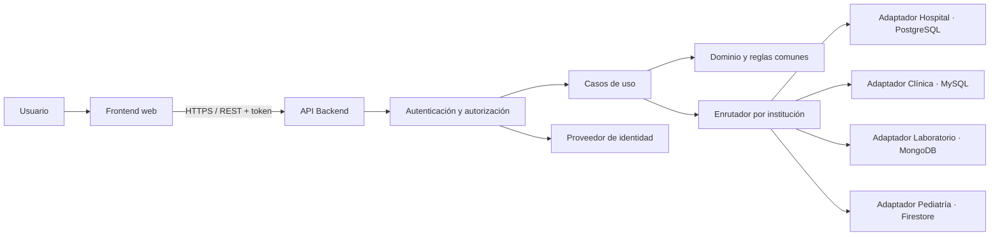

# Diseño principal del proyecto

## 1. Propósito del documento

Este documento especifica el alcance, las decisiones de modelado, las reglas de negocio, la arquitectura y los criterios de aceptación para implementar las dos entregas. Las decisiones descritas son el diseño adoptado; su implementación y sus pruebas siguen pendientes salvo donde se indique evidencia existente.

El proyecto es una aplicación cliente-servidor para historiales clínicos de cuatro instituciones independientes. Debe demostrar cómo una interfaz y reglas de negocio comunes pueden trabajar con cuatro motores diferentes, seleccionados según la institución del usuario autenticado.

### Fuentes del alcance

- `Primera Entrega Proyecto (1).pdf`: levantamiento, modelos, entidades, atributos, clasificación de información y operaciones previstas.
- `Proyecto final bases II (1) (4).pdf`: instrucciones de la aplicación final, restricciones de motores y resultados esperados. Es el mismo archivo que `Proyecto final bases II (1) (5).pdf` (SHA-256 idéntico, verificado el 24/10/2026; DEC14 del plan).
- `Database/hospital_general_postgresql.sql` y `Database/clinica_odontologica_mysql.sql`: esquemas SQL de partida que ya están en el repositorio.

Los modelos de la primera entrega son una base que puede corregirse con la retroalimentación del curso. Antes de cambiar reglas o datos, documentar cualquier diferencia relevante con estos requisitos.

La consigna final define las obligaciones académicas; la primera entrega aporta el levantamiento y los modelos de partida. Las ampliaciones elegidas por el equipo se identifican expresamente en las secciones 3 y 14. La auditoría `Agente/AUDITORIA_DISENO_PROYECTO.md` conservaba el diagnóstico de la versión anterior (referencia histórica: el archivo no está en el repositorio al 24/10/2026, DEC15); la sección 15 traza sus correcciones documentales. No se ha recibido retroalimentación docente que permita certificar ese requisito.

## 2. Requisitos del proyecto

### 2.1 Requisitos obligatorios de la entrega

1. Implementar una aplicación cliente-servidor funcional para consultar y administrar historiales clínicos.
2. Cubrir cuatro instituciones y asignar un motor distinto a cada una. El mismo motor no puede asignarse a más de una institución.
3. Justificar por escrito la asignación por volumen, estructura y necesidad de transacciones. La consigna permite elegir qué institución corresponde a cada motor y descarta opciones ligeras como SQLite, Realm o LiteDB. La selección concreta de este proyecto aparece separada como decisión adoptada en la tabla siguiente.
4. Usar arquitectura hexagonal como base para que cambiar el adaptador de persistencia no obligue a reescribir los casos de uso.
5. Enrutar las operaciones al motor correspondiente a la institución del usuario autenticado.
6. Mantener operaciones equivalentes en los cuatro motores y mostrar la información en una interfaz coherente, independiente del motor activo.
7. Registrar nuevos pacientes e historiales, mantener historiales existentes, y permitir archivar o desactivar historiales sin borrar su historia clínica.
8. Permitir registrar consultas, diagnósticos, tratamientos y medicamentos recetados, además de los procesos particulares de cada institución.
9. Definir y justificar qué información se embebe y cuál se referencia en MongoDB y Firestore.
10. Entregar un documento comparativo breve que explique, por motor, modelado, consistencia, seguridad y asignación por volumen, estructura y necesidad de transacciones.
11. Incorporar las correcciones de la retroalimentación de Entrega I y conservar evidencia de su resolución. Mientras no esté disponible, este punto queda pendiente de verificación.

### Decisiones adoptadas para el proyecto

| Institución | Motor elegido por el equipo | Modelo de partida |
|---|---|---|
| Hospital General | PostgreSQL | 46 entidades relacionales de la primera entrega y SQL existente. |
| Clínica Odontológica | MySQL | 14 entidades relacionales de la primera entrega y SQL existente. |
| Laboratorio Clínico | MongoDB | 22 colecciones de la primera entrega, ampliadas para el núcleo común de la sección 5.5. |
| Centro Médico Pediátrico | Cloud Firestore | Seis colecciones clínicas iniciales, con responsables compartidos y subcolecciones definidas en 3.5.1. |

NestJS, React, Vite y Firebase Authentication son decisiones técnicas del equipo. La tecnología de aplicación es libre según la consigna. Cambiar una decisión requiere actualizar su justificación, los adaptadores afectados y las pruebas; conservar cuatro motores distintos.

### Entregables de la primera entrega que fundamentan la segunda

La consigna establece para Entrega I los modelos y operaciones que sirven de base a la aplicación; el PDF de la primera entrega contiene el trabajo realizado:

- Diagramas entidad–relación y modelos relacionales para las instituciones que usan motores relacionales.
- Entidades y atributos identificados por institución.
- Modelos relacionales normalizados e implementación inicial en los motores relacionales elegidos.
- Clasificación de información pública, confidencial y restringida.
- Descripción en lenguaje sencillo de las operaciones necesarias, como punto de partida de la aplicación de la segunda entrega.

### Clasificación de información

- **Pública:** información general que no identifica pacientes, como servicios y catálogos públicos de vacunas.
- **Confidencial:** datos que identifican o permiten contactar a pacientes y responsables, además de información administrativa de citas.
- **Restringida:** información clínica vinculada a personas, como alergias, antecedentes, síntomas, crecimiento, diagnósticos, recetas, resultados y vacunas aplicadas.

La clasificación determina qué roles pueden consultar o modificar cada dato; los registros clínicos requieren acceso limitado y trazabilidad.

### 2.2 Requisitos funcionales comunes

- Registrar, buscar y consultar pacientes; evitar duplicados y reutilizar el expediente existente.
- Crear y consultar historiales clínicos; conservar eventos previos aunque el expediente se archive o desactive.
- Administrar citas: programar, reprogramar, cancelar y asignar al profesional correspondiente.
- Registrar consultas asociadas al paciente y, cuando corresponda, a la cita y al profesional que atendió.
- Consultar en orden cronológico los registros del historial.
- Registrar diagnósticos, tratamientos, recetas y medicamentos con sus atributos y observaciones.
- Controlar la existencia y pertenencia de las relaciones: una consulta, resultado o aplicación de vacuna debe corresponder al paciente indicado.
- Validar estados permitidos, campos obligatorios, fechas, valores y reglas de unicidad.
- Registrar quién hizo cambios sensibles y mantener la trazabilidad de correcciones.
- Manejar concurrencia para evitar registros duplicados, actualizaciones perdidas, doble cobro o descuentos de inventario incorrectos.

### 2.3 Requisitos no funcionales y de calidad

- **Seguridad:** autenticación, autorización en el servidor, permisos por institución y rol, mínimo privilegio y auditoría de operaciones importantes.
- **Privacidad:** datos de contacto e identificación son confidenciales; información clínica es restringida. Utilizar datos sintéticos en desarrollo y demostraciones.
- **Consistencia:** cada flujo debe completar o revertir sus escrituras relacionadas dentro de las garantías de su motor.
- **Mantenibilidad:** dominio y casos de uso independientes de los clientes de base de datos y del framework web.
- **Usabilidad:** interfaz comprensible para personal médico, secretaría y laboratorio; no mostrar detalles del motor al usuario.
- **Configuración segura:** secretos fuera del repositorio; almacenar solo `.env.example` sin valores reales y configurar credenciales por entorno.

Estos requisitos son metas del proyecto académico. No representan por sí solos una certificación clínica, legal o de cumplimiento normativo.

## 3. Instituciones y módulos funcionales

### 3.1 Módulos transversales de la aplicación

| Módulo | Responsabilidad |
|---|---|
| Autenticación | Iniciar y cerrar sesión; verificar identidad y estado de la cuenta. |
| Autorización | Comprobar permisos por rol, institución y operación en el servidor. |
| Enrutamiento institucional | Resolver el adaptador de persistencia usando la institución verificada del usuario. |
| Pacientes e historiales | Crear, buscar y actualizar datos administrativos; consultar y archivar expedientes. |
| Citas | Programar, reprogramar, cancelar y consultar citas. |
| Consultas | Registrar atención y relacionarla con paciente, historial, cita y profesional. |
| Diagnósticos y tratamientos | Registrar los diagnósticos y tratamientos que correspondan a una consulta. |
| Recetas y medicamentos | Guardar la receta emitida con sus dosis, frecuencia, duración, vía e indicaciones. |
| Auditoría | Registrar actor, acción, fecha y recurso afectado para operaciones relevantes. |
| Reportes y búsquedas | Facilitar las consultas pedidas por cada institución y su historial cronológico. |

Las cuatro instituciones implementan el núcleo común de la sección 5.5 con los mismos casos de uso y contratos. Los módulos especializados agregan capacidades institucionales. Las diferencias de tablas o documentos se resuelven dentro de los adaptadores; las reglas particulares se expresan como políticas de dominio, sin condicionar la lógica por nombre de motor.

### 3.2 Hospital General — PostgreSQL

**Necesidad principal:** expediente relacional amplio y operaciones que requieren integridad transaccional.

Módulos que debe cubrir:

- Pacientes, contactos de emergencia e historial clínico.
- Alergias, antecedentes médicos y personal médico/especialidades.
- Citas, consultas y signos vitales.
- Catálogo de diagnósticos, diagnósticos, tratamientos, procedimientos realizados.
- Medicamentos, principios activos, unidades, recetas y detalles.
- Órdenes de examen, pruebas, resultados versionados y sus parámetros.
- Hospitalizaciones, diagnósticos asociados, habitaciones, camas y asignaciones.
- Usuarios, roles y auditoría.
- Aseguradoras, planes, titulares, pólizas y afiliaciones de pacientes.

El esquema inicial define 46 entidades en `Database/hospital_general_postgresql.sql`.

Conservar los atributos y relaciones de la primera entrega, pp. 8–23. Verificar pertenencia al mismo paciente al enlazar hospitalización, consultas y diagnósticos. La asignación de cama debe bloquear solapamientos para una misma cama y hospitalización; ingreso, asignación y auditoría se confirman juntos. Recetas y resultados conservarán su contenido histórico mediante las extensiones de la sección 14.

### 3.3 Clínica Odontológica — MySQL

**Necesidad principal:** agenda y flujo de atención odontológica con datos estructurados para una clínica pequeña.

Módulos que debe cubrir:

- Pacientes y expediente clínico odontológico.
- Secretarías y odontólogos; colegiado único para el odontólogo.
- Citas con paciente, odontólogo y secretaria que la gestionó.
- Antecedentes y consultas odontológicas vinculadas a citas e historial.
- Catálogos de diagnóstico y tratamiento, con sus relaciones a consultas.
- Recetas y detalles de medicamentos.

El esquema inicial define 14 entidades en `Database/clinica_odontologica_mysql.sql`. El modelo contempla un historial por paciente y una consulta asociada como máximo a cada cita.

Conservar los atributos de la primera entrega, pp. 24–29. Toda consulta odontológica requiere una cita PROGRAMADA de la clínica (política institucional, DEC03; el SQL exige `id_cita NOT NULL`). Una cita cancelada no genera consulta; al atenderla se comprueba que paciente, historial y odontólogo correspondan y se marca ATENDIDA en la misma transacción. Se conserva una receta lógica por consulta, con sus medicamentos y revisiones históricas. Agregar identidad, autorización y auditoría sin atribuir una contraseña local a secretarias u odontólogos.

### 3.4 Laboratorio Clínico — MongoDB

**Necesidad principal:** ciclo completo de órdenes, muestras y resultados con parámetros variables por tipo de prueba.

Módulos que debe cubrir:

- Pacientes y solicitantes.
- Catálogo versionable de tipos de muestra, métodos, pruebas y parámetros.
- Órdenes con sus ítems de pruebas, prioridades, indicaciones y precios acordados.
- Muestras identificadas, recepción, rechazo y eventos de trazabilidad.
- Resultados con componentes flexibles, equipo, analista, validación y versiones.
- Informes que conserven los resultados y versiones incluidos cuando se emitieron.
- Equipos, proveedores, reactivos, lotes, movimientos de inventario y controles de calidad.
- Personal, usuarios, roles, auditoría, facturas, líneas y pagos.

### 3.4.1 Modelo MongoDB adoptado

Se conservan los atributos de la primera entrega, pp. 30–42, con las ampliaciones registradas en la sección 14. Las 22 colecciones base son: `pacientes`, `solicitantes`, `tipos_muestra`, `metodos`, `pruebas`, `ordenes`, `muestras`, `eventos_muestra`, `resultados`, `informes`, `equipos`, `proveedores`, `reactivos`, `lotes_reactivo`, `movimientos_reactivo`, `controles_calidad`, `personal`, `usuarios`, `roles`, `auditoria`, `facturas` y `pagos`.

| Agregado / colección | Datos embebidos elegidos | Referencias elegidas y motivo |
|---|---|---|
| `pacientes` | Contactos acotados y cabecera `historial` con identificador, apertura, estado y baja. | No contiene listas de órdenes, consultas ni exámenes: crecen durante toda la vida del paciente. |
| `pruebas` | `parametros[]`, con identificador, tipo de valor, obligatoriedad, unidades y opciones. | `metodo_id` apunta a una versión exacta y `tipo_muestra_ids` a catálogos; una versión utilizada no se sobrescribe. |
| `ordenes` | `items[]` con `item_id`, versión exacta de prueba, prioridad, estado y precio acordado. | `paciente_id`, `solicitante_id` y actor. Las muestras y resultados se consultan aparte por orden. |
| `muestras` / `eventos_muestra` | Cada evento embebe su rectificación: campo, valor anterior/nuevo y motivo. | Muestra referencia orden e ítems; cada evento es documento independiente referenciado a muestra para evitar un arreglo de seguimiento ilimitado. |
| `resultados` | Componentes y procedencia histórica de muestras; unidades y referencias aplicadas. | Orden, ítem, versión de prueba, muestras, equipo, analista y validador. Cada versión es un documento inmutable tras validación. |
| `informes` | Cabecera histórica del paciente/solicitante. | `resultado_ids` contiene identificadores de versiones exactas; serie y versión distinguen rectificaciones del informe. |
| `facturas` / `pagos` | Factura embebe receptor y líneas con descripciones/precios históricos. | Orden y emisor; pagos son documentos independientes por factura para conservar reintentos y conciliación. |
| `lotes_reactivo` / `movimientos_reactivo` | Lote conserva `revision_stock`, contador técnico para serializar consumos. | Reactivo, proveedor, resultado o control. Cada movimiento es independiente; el saldo se deriva de movimientos confirmados. |
| `controles_calidad` | Mediciones, límites y evaluación aplicados en ese control. | Prueba/versiones, equipo y operador: no dependen del valor actual del catálogo. |
| `usuarios` / `roles` / `auditoria` | Usuario contiene identificadores de roles; auditoría contiene cambios mínimos necesarios protegidos. | Usuario referencia personal y opcionalmente solicitante médico; identidad externa y autorización se definen en 5.3.1. |
| `citas` / `consultas_clinicas` | Consulta embebe diagnósticos, tratamientos y receta histórica; los identificadores internos son estables. | **Ampliación adoptada** del modelo base para el núcleo común: paciente/historial, cita y profesional médico autorizado. Resultados de laboratorio siguen separados. |
| `revisiones` | Instantánea de la versión anterior y sus metadatos, en cada documento independiente. | Colección técnica para consulta clínica, receta, factura u otro agregado corregido: `tipo_recurso`, `recurso_id`, `version`, `actor_id`, fecha y motivo; unicidad por recurso/versión. Resultados e informes conservan además sus series/versiones nativas. |

`solicitantes`, `tipos_muestra`, `metodos`, `equipos`, `proveedores`, `reactivos` y `personal` mantienen documentos propios, porque se administran independientemente y se reutilizan. `citas` y `consultas_clinicas` amplían las 22 colecciones clínicas a 24. `operaciones`, `identidades_paciente` y `revisiones` son colecciones técnicas para idempotencia, unicidad e historia; no se presentan como entidades de la primera entrega. Las listas de diagnósticos/tratamientos y el objeto receta de la consulta tienen los mismos atributos del contrato común y los detalles clínicos equivalentes a los definidos en I, pp. 50–51, sin incorporar un control pediátrico al laboratorio.

Elegir documentos con un máximo de 256 KiB y 100 elementos por arreglo de agregado como límites iniciales del proyecto; validar tamaño total antes de escribir. Superar un límite produce `LIMITE_AGREGADO`, sin truncar datos. Los eventos longitudinales siempre permanecen en documentos separados. Estos límites son decisiones de implementación, no requisitos del PDF.

Crear índices únicos para código de paciente, número de orden, código de barras, `(codigo, version)` de prueba/método, `(serie_resultado_id, version)`, `(serie_informe_id, version)`, número de factura y las claves de operaciones idempotentes. La identificación personal se reserva por tipo/número normalizados; documentos ausentes no comparten una clave vacía. Indexar las búsquedas de 3.4.2 por paciente, fecha, estado y referencias. Validar estructura, tipos y campos obligatorios con validadores de colección y relaciones en la aplicación.

### 3.4.2 Operaciones y reglas del laboratorio

1. **Pacientes y catálogos:** registrar/buscar/actualizar pacientes y solicitantes; administrar tipos de muestra, métodos y pruebas. Modificar una prueba/método utilizado crea una versión; desactivarlo impide nuevas órdenes sin borrar versiones anteriores.
2. **Órdenes:** crear para paciente activo con pruebas vigentes, ítems identificables, solicitante, prioridad, indicaciones, moneda y precios fijados. Una orden no referencia precios futuros del catálogo.
3. **Muestras:** generar código único; registrar toma, recepción, aceptación, rechazo con motivo, traslado y procesamiento. Una retoma crea otra muestra. Una rectificación conserva campo, valores, actor, fecha y motivo mediante evento; no sustituye la muestra previa.
4. **Resultados:** exigir que prueba/ítem y todas las muestras aceptadas pertenezcan a la misma orden y paciente; validar componentes contra la versión de prueba. Registrar equipo, analista, valores, unidades y referencias. Validar requiere permiso específico y actor/fecha. Corregir un resultado validado crea otra versión en la misma serie; repetir el análisis crea otra serie. Nunca convertir automáticamente un resultado en diagnóstico o receta.
5. **Informes:** emitir únicamente con resultados VALIDADOS de una misma orden y paciente. Guardar sus identificadores/versiones exactos, cabecera histórica, emisor, fecha, URI y hash del archivo. Una corrección posterior no altera el informe emitido; emitir una nueva versión enlazada al anterior. Preparar el archivo fuera de la transacción y publicar el estado EMITIDO solo al comprobar su almacenamiento e integridad; un fallo deja BORRADOR sin informe emitido parcial.
6. **Facturas y pagos:** conservar líneas y receptor al emitir; una corrección genera revisión/anulación auditada sin reescribir lo emitido. Calcular `total_factura = suma(cantidad × precio_unitario - descuento_importe + impuesto_importe)`; `total_pagado = suma(pagos CONFIRMADOS no anulados)`; `saldo_pendiente = total_factura - total_pagado`. Usar unidades monetarias menores enteras por moneda y redondear cada línea antes de sumar; rechazar moneda distinta, importes no positivos y pagos superiores al saldo en el alcance académico. No mezclar monedas ni usar coma flotante. Al pagar/revertir, actualizar `revision_cobro` de factura dentro de la transacción con pago, operación y auditoría; comprobar otra vez el saldo tras un conflicto. Reenviar el mismo pago no cobra dos veces.
7. **Reactivos y equipos:** administrar equipos/proveedores/reactivos/lotes. Registrar ENTRADA, CONSUMO, AJUSTE_ENTRADA, AJUSTE_SALIDA y BAJA con cantidad positiva y unidad compatible. `disponible = entradas + ajustes_entrada - consumos - ajustes_salida - bajas` de movimientos confirmados. Un lote vencido/inactivo no admite consumo; el lote inicial recibe movimiento de entrada. Para un consumo, leer saldo y actualizar `revision_stock` del lote dentro de la misma transacción que crea movimiento, operación y auditoría; consumos concurrentes del mismo lote generan conflicto y se reintentan comprobando saldo actualizado. Así se evita que dos lecturas del mismo saldo permitan existencias negativas.
8. **Calidad:** registrar mediciones, unidades, objetivos y límites aplicados, evaluación, equipo, prueba y operador; conservarlos aunque cambie el catálogo.
9. **Acceso y búsquedas:** crear/desactivar usuarios, asignar roles y auditar cambios. Consultar órdenes por paciente/rango de fechas, muestras por estado pendiente, resultados validados, informes por orden/fecha, facturas y sus pagos/saldos, y movimientos por lote/tipo/fecha. Todas las búsquedas incluyen autorización, orden estable y paginación de 5.6.

Los estados adoptados son: orden CREADA → EN_PROCESO → COMPLETADA, o CANCELADA con motivo antes de completarla; muestra TOMADA → RECIBIDA → ACEPTADA → PROCESADA, o RECHAZADA desde recepción/aceptación con motivo; resultado BORRADOR → VALIDADO; informe BORRADOR → EMITIDO, con anulación auditada; factura BORRADOR → EMITIDA → ANULADA; pago CONFIRMADO → ANULADO mediante registro de reversión. Un resultado validado y un documento emitido se corrigen mediante nueva versión, conservando el original. Una orden se completa cuando todos sus ítems no cancelados tienen resultado validado; rechazar una muestra no cancela automáticamente la orden. No se anula una factura con pagos sin registrar primero sus reversiones. Las transiciones ilegales devuelven `ESTADO_INVALIDO` sin escrituras parciales.

### 3.5 Centro Médico Pediátrico — Firebase / Cloud Firestore

**Necesidad principal:** consultas frecuentes centradas en el paciente y seguimiento longitudinal de crecimiento y vacunación.

Módulos que debe cubrir:

- Pacientes, responsables y autorización de atención al menor.
- Alergias y antecedentes.
- Pediatras, citas y consultas pediátricas.
- Mediciones de crecimiento por consulta: peso, talla, perímetro cefálico, temperatura y frecuencia cardíaca.
- Diagnósticos, tratamientos y recetas por consulta.
- Catálogo de vacunas, dosis y edad recomendada.
- Aplicaciones de vacunas con paciente, dosis, fecha, lote, sitio y pediatra responsable.
- Consulta cronológica de consultas, crecimiento y vacunas; revisión de dosis pendientes.
- Archivo/reactivación del historial y registro de cambios clínicos.

### 3.5.1 Modelo Firestore adoptado

Conservar los atributos clínicos de la primera entrega, pp. 47–51, con las siguientes ubicaciones definitivas. Todas pertenecen a la base exclusiva de pediatría; las rutas no dependen de una institución enviada por el cliente.

| Ruta | Contenido y referencias | Justificación |
|---|---|---|
| `pacientes/{pacienteId}` | Perfil, fecha de apertura, estado del historial, motivo/actor/fecha de baja, versión de concurrencia. | Documento pequeño de lectura frecuente; no acumula consultas, vacunas ni listas históricas. |
| `responsables/{responsableId}` | Identificación normalizada única, nombres y contactos actuales. | **Ampliación adoptada:** una persona compartida por varios menores tiene una única fuente de datos administrativos. |
| `pacientes/{pacienteId}/responsables/{responsableId}` | Referencia al responsable, parentesco, `es_principal`, `autoriza_atencion`, vigencia y fecha/actor del vínculo. | La autorización y el parentesco pertenecen a la relación con cada menor; actualizar un contacto no cambia autorizaciones. |
| `pacientes/{pacienteId}/alergias/{alergiaId}` | Datos de alergia/reacción/severidad/estado y registro. | Se separa del perfil para conservar evolución sin arreglo ilimitado. |
| `pacientes/{pacienteId}/antecedentes/{antecedenteId}` | Tipo, descripción y fecha; revisiones auditadas. | Crecimiento independiente del perfil. |
| `pediatras/{pediatraId}` | Datos profesionales de la fuente, colegiado único y estado. | Se reutilizan entre citas, consultas y vacunas. |
| `citas/{citaId}` | Paciente, pediatra, fecha, motivo, estado y creación. | Consultas de agenda por profesional/fecha sin recorrer pacientes. |
| `consultas/{consultaId}` | Referencias paciente/cita/pediatra; motivo, síntomas, observaciones, **un objeto opcional** `control_crecimiento`, diagnósticos y tratamientos embebidos; una receta lógica con medicamentos históricos embebidos. | Se lee como unidad de atención. Las revisiones previas se guardan en `consultas/{consultaId}/versiones/{versionId}`, sin acumularlas en un arreglo. |
| `vacunas/{vacunaId}` | Nombre, enfermedad, fabricante y puntero `version_vigente`. `vacunas/{vacunaId}/versiones/{versionId}` conserva una instantánea inmutable del catálogo con `dosis[]`, `dosis_id`, número y edad recomendada. | Las dosis acotadas se leen con la versión exacta de su vacuna; cambiar esquema crea otra versión, sin editar la anterior. |
| `pacientes/{pacienteId}/esquemas/{vacunaId}` | Referencia a vacuna y versión asignada, actor/fecha y estado. | La evaluación de pendientes utiliza el esquema asignado explícitamente, no el catálogo más reciente. Cambiar asignación conserva auditoría y no elimina aplicaciones. |
| `aplicaciones_vacuna/{pacienteId_vacunaId_dosisId}` | Paciente, vacuna y dosis exacta, versión de esquema, pediatra, fecha, lote, sitio, observaciones y versión. | Identificador determinista codificado sin colisiones reserva una sola aplicación lógica por paciente/vacuna/dosis. Una corrección conserva el ID y genera revisión en su subcolección `versiones`. |
| `usuarios/{usuarioId}`, `roles/{rolId}`, `auditoria/{eventoId}` | Identidad externa, permisos, actores y cambios de 5.3.1. | Extensión transversal de acceso/auditoría, separada de datos clínicos. |
| `operaciones/{clave}`, `identidades_paciente/{clave}`, `identidades_responsable/{clave}`, `colegiados/{clave}` | Reservas deterministas y referencias al recurso creado. | Colecciones técnicas para idempotencia y unicidad mediante transacciones; no confundirlas con entidades clínicas de la primera entrega. |

La separación de responsables, alergias y antecedentes cambia el embebido del modelo inicial y queda registrada en la sección 14. La consulta mantiene juntos sus datos acotados; no se guardan sus referencias en una lista del paciente. Se adoptan los límites de agregado de 3.4.1 para consultas y catálogos; una petición excesiva se rechaza antes de escribir y nunca se trunca. Consultar historiales por documentos de atención y subcolecciones, con índices por `(paciente_id, fecha_hora, id)`, citas por `(pediatra_id, fecha_hora)` y estado/fecha cuando el filtro lo requiera. Los índices reales se versionarán con la implementación.

### 3.5.2 Reglas pediátricas obligatorias

- El alta del menor crea paciente, apertura del historial y vínculos con **al menos un responsable principal** en una transacción. Se admiten varios principales: la fuente no impone exactamente uno. Registrar quién autoriza; ser principal no equivale automáticamente a autorizar atención. Para iniciar una consulta debe haber al menos un vínculo vigente que autorice y debe registrarse cuál se utilizó.
- Modificar responsables no puede dejar al paciente sin principal. Toda modificación de vínculos actualiza también la versión del paciente en la transacción, para impedir que dos bajas concurrentes eliminen a todos los principales. Los datos administrativos se leen de `responsables`; una actualización se refleja en todos los menores vinculados. La consulta conserva el nombre/identificación y autorización utilizados en la fecha de atención como evidencia histórica.
- Por consulta hay **máximo un control de crecimiento**, modelado como objeto y no lista. Peso y talla positivos; otras mediciones deben ser numéricas y validadas. Comparar controles de distintas consultas por fecha y conservar revisiones si se corrige uno. Calcular edad e IMC desde nacimiento, peso y talla, sin duplicarlos como valores permanentes; sin talla válida no calcular IMC. No generar interpretaciones clínicas automáticas.
- Admitir varios diagnósticos y tratamientos por consulta, con sus observaciones/fechas; cuando existan diagnósticos, identificar uno como principal. La receta emitida conserva nombre, presentación, concentración, dosis, frecuencia, duración, vía e indicaciones tal como se emitieron. Cambiar un catálogo no altera una receta; corregirla crea una revisión con motivo y actor.
- Registrar vacuna exige paciente, pediatra, vacuna y dosis existentes y compatibles con la versión de esquema asignada. El `dosis_id` es estable entre versiones cuando identifica la misma dosis; no se renumera para eludir unicidad. Crear la aplicación determinista en transacción; dos solicitudes para la misma dosis no crean dos aplicaciones. Una rectificación mantiene el registro lógico y agrega una versión; una nueva administración de la misma dosis no se disfraza de corrección. El catálogo utilizado en la demo es sintético, no una recomendación médica.
- Calcular dosis pendientes con el esquema/versiones asignados al paciente, las dosis cuya edad recomendada ya se alcanzó y las aplicaciones vigentes no anuladas. Una dosis futura se muestra como programada, una debida sin aplicación como pendiente, y una aplicada como cumplida. La corrección/anulación conserva el historial y recalcula la vista.
- Mostrar consultas, controles y vacunas cronológicamente; archivar/reactivar según 5.7. Antes de escribir validar existencia, institución, pertenencia al paciente y versión vigente. Los callbacks transaccionales solo operan sobre datos, sin notificaciones ni otros efectos externos.

## 4. Roles iniciales y permisos

Los roles siguientes son el conjunto inicial adoptado. Cada cuenta recibe solo los permisos necesarios y todo acceso se valida en el backend, incluidas lecturas, búsquedas y exportaciones. Ocultar una opción en pantalla no es autorización.

| Rol | Acceso esperado |
|---|---|
| Administrador institucional | Gestionar usuarios, roles y catálogos de su institución; consultar auditoría según permisos. |
| Médico / odontólogo / pediatra | Consultar pacientes de su institución y registrar consultas, diagnósticos, tratamientos, recetas y acciones clínicas permitidas. |
| Médico responsable de atención en laboratorio | Usar el núcleo clínico común solo cuando esté vinculado a un solicitante médico individual activo y tenga permisos clínicos explícitos; no se asigna este rol a analistas por defecto. |
| Secretaría | Registrar pacientes y administrar citas; no modificar resultados o notas clínicas restringidas. |
| Personal de laboratorio | Administrar órdenes y muestras según función; analizar o validar resultados solo con permisos correspondientes. |
| Auditor / consulta | Acceso de lectura limitado y trazable, si se incluye en la demo. |

Un usuario pertenece a una institución. Las solicitudes no pueden elegir arbitrariamente otro motor ni acceder a datos de otra institución.

Permisos mínimos independientes: `pacientes.administrar`, `historial.leer`, `historial.archivar`, `citas.administrar`, `consultas.registrar`, `diagnosticos.registrar`, `tratamientos.registrar`, `recetas.emitir`, `resultados.analizar`, `resultados.validar`, `informes.emitir`, `cobros.administrar`, `inventario.administrar`, `usuarios.administrar` y `auditoria.leer`. Administración de usuarios no concede acceso clínico automáticamente. Secretaría accede al perfil administrativo y agenda; los campos clínicos se omiten de sus respuestas. Análisis y validación son permisos distintos aunque la demo pueda asignarlos a una misma cuenta autorizada. Ningún resultado se transforma en diagnóstico por decisión del analista.

## 5. Arquitectura adoptada

### 5.1 Estilo: monolito modular con arquitectura hexagonal

Se adopta un backend modular único y una interfaz web. Los módulos y puertos internos aíslan los dominios y las bases de datos; no se necesitan microservicios para demostrar los requisitos del proyecto.

### 5.2 Capas y responsabilidades

1. **Dominio:** entidades/valores y reglas que no dependen de NestJS ni de bases de datos.
2. **Aplicación:** casos de uso como `RegistrarPaciente`, `ProgramarCita`, `RegistrarConsulta`, `AgregarDiagnostico`, `EmitirReceta`, `CrearOrdenLaboratorio`, `ValidarResultado` y `RegistrarVacuna`.
3. **Puertos:** interfaces que los casos de uso necesitan, por ejemplo `RepositorioPaciente`, `RepositorioCitas`, `RepositorioHistorial`, `RepositorioLaboratorio`, `RepositorioVacunas`, `Autenticacion` y `Auditoria`.
4. **Adaptadores de entrada:** API REST, validación de solicitudes y conversión de errores a respuestas HTTP.
5. **Adaptadores de salida:** repositorios y transacciones para PostgreSQL, MySQL, MongoDB y Firestore, además del proveedor de identidad.
6. **Composición:** configuración que une cada puerto con su adaptador y resuelve institución, conexión y credenciales desde configuración del servidor.

El frontend no importa SDKs de PostgreSQL, MySQL o MongoDB, ni decide el motor. Todas las escrituras de datos clínicos pasan por la API y las reglas del backend.

### 5.3 Flujo de enrutamiento institucional

1. El usuario se autentica y recibe un token firmado.
2. El backend verifica firma, vigencia y estado del token.
3. El backend obtiene `uid` e institución de claims firmados y verifica que la institución esté en la configuración permitida. Utiliza la institución como localizador inicial y busca en su base la cuenta vinculada al `uid`; los roles y permisos vigentes se cargan desde esa cuenta, no desde el body ni desde claims de rol desactualizados.
4. Los guards comprueban cuenta ACTIVA, coincidencia de institución, acceso a la operación y pertenencia del recurso. Solo después se ejecuta el caso de uso; no se devuelven datos institucionales mientras se valida identidad.
5. El selector de persistencia resuelve el adaptador permitido para esa institución.
6. El caso de uso ejecuta sus reglas y persiste los cambios con el mecanismo transaccional del motor activo.
7. La respuesta se convierte al contrato común de la API; no revela tablas, colecciones ni proveedor usado.

Firebase Authentication es el proveedor de identidad adoptado. Firestore conserva exclusivamente los datos de pediatría; identidad compartida no significa almacenar expedientes de las otras instituciones en Firestore. Tanto lecturas como escrituras clínicas pasan por la API.

### 5.3.1 Identidad externa, usuarios internos y auditoría

- **Identidad:** Firebase Authentication administra credenciales. El backend valida firma, emisor/proyecto, audiencia, caducidad y revocación mediante el SDK. Un token ausente, inválido, vencido o revocado devuelve `401 NO_AUTENTICADO`.
- **Vínculo institucional:** cada cuenta local contiene `id_usuario`, `auth_uid` único, `proveedor_identidad = FIREBASE`, `institucion_id`, estado PENDIENTE/ACTIVO/INACTIVO, roles y vínculo profesional opcional. El claim `institucion_id` solo puede asignarlo el servicio administrativo; debe coincidir con la cuenta en el motor seleccionado. Una cuenta ausente/inactiva devuelve `403 CUENTA_NO_HABILITADA` sin revelar datos.
- **Autoridad de permisos:** roles y permisos se leen de la base institucional en cada petición autorizada; no se cachean en esta primera versión. Una modificación local tiene efecto en la siguiente petición aunque el token siga firmado. Los recursos clínicos se autorizan también por paciente/función, no solo por ruta.
- **Usuarios y profesionales:** un usuario administrativo puede carecer de vínculo médico. Para emitir receta o registrar acción médica se exige un profesional activo asociado al usuario: personal médico, odontólogo, pediatra o solicitante médico individual autorizado según institución. El cliente no puede suplantar al profesional enviando otro identificador.
- **Esquemas:** en PostgreSQL se agrega `auth_uid` único y proveedor, se hace opcional el vínculo `id_personal` para cuentas administrativas y se reemplaza la obligación de `contrasena_hash` por identidad externa. En MongoDB se elimina la obligatoriedad del hash local y se añade el mismo vínculo. En MySQL se agregan usuarios/roles/relaciones/auditoría y vínculos explícitos a secretaria u odontólogo. Firestore usa las colecciones definidas en 3.5.1. No habrá autenticación local alternativa ni hashes ficticios. Las migraciones preservan los identificadores internos existentes y sus referencias históricas.
- **Alta y cambios:** provisionar primero una cuenta PENDIENTE, vincular identidad/claim con una sola institución y activarla al completar el proceso. El servicio de provisión verifica que el `uid` no esté activo en otra institución. Un fallo intermedio mantiene la cuenta sin acceso y permite reintentar con la misma clave. No se promete atomicidad entre Firebase Authentication y las bases institucionales.
- **Baja y cierre de sesión:** desactivar primero la cuenta local y revocar sesiones de Firebase; un fallo en la revocación se reintenta sin restaurar el acceso local. El cierre de sesión de esta versión revoca las sesiones del usuario y borra el estado local del cliente. Cambiar de institución se hace como baja y nueva vinculación administrativa, sin mover expedientes ni ejecutar transacciones entre motores.
- **Auditoría:** cada cambio relevante guarda ID interno del actor, `auth_uid`, institución, acción, tipo/ID público del recurso, fecha UTC, correlación, motivo y versión afectada. Auditar correcciones con los valores necesarios en almacenamiento protegido, sin volcarlos a logs generales. El usuario de aplicación puede insertar auditoría, no editar/borrar eventos. En cambios transaccionales, datos y auditoría se confirman juntos; si falla auditoría, se revierte el cambio.

La verificación básica del ID token no comprueba por sí sola revocación; se usa su comprobación explícita y el estado local. Referencias: [verificación de tokens](https://firebase.google.com/docs/auth/admin/verify-id-tokens) y [administración de sesiones](https://firebase.google.com/docs/auth/admin/manage-sessions).

### 5.4 Consistencia por motor

- **PostgreSQL:** agrupar escrituras dependientes de una consulta/diagnóstico/receta o ingreso en transacciones explícitas; usar claves foráneas, unicidad y `CHECK` cuando corresponda.
- **MySQL:** utilizar tablas InnoDB y transacciones explícitas para cambios que deban confirmarse juntos; mantener índices y restricciones en el esquema.
- **MongoDB:** el entorno debe soportar transacciones mediante replica set o clúster compatible; una instancia standalone no satisface este diseño. Usar transacciones multi-documento para alta de paciente/reservas, consulta/auditoría, pagos y movimientos de inventario. El contador de revisión de lote/factura fuerza conflicto entre consumos/pagos concurrentes; reintentar leyendo los saldos actualizados.
- **Firestore:** usar transacciones o escrituras en lote cuando varias escrituras deban ser atómicas. El callback de transacción debe ser seguro para repetición y no enviar notificaciones ni producir otros efectos externos.
- No diseñar una transacción distribuida entre motores: cada solicitud pertenece a una institución y modifica una sola base institucional.

La consistencia visible debe ser equivalente para el usuario aunque la implementación de cada adaptador sea distinta. Documentar las limitaciones y garantías reales, no declarar consistencia global entre bases.

### 5.5 Núcleo común y equivalencia entre motores

Las cuatro instituciones soportan **registrar paciente y abrir historial, registrar consulta, agregar diagnóstico/tratamiento, emitir receta, consultar cronología y archivar**. Gestionar citas aplica a las agendas visibles (hospital, odontología, pediatría) y la reactivación pública solo a pediatría; ver 5.8. Comparten los mismos casos de uso de aplicación y sus invariantes. Una consulta es una atención documentada por un profesional autorizado; un diagnóstico es una conclusión clínica registrada; un resultado de laboratorio conserva su tipo y no sustituye a un diagnóstico.

**Decisión sobre laboratorio:** el levantamiento inicial no incluye atención médica ni recetas. Se adopta una ampliación acotada del modelo para cumplir los ejemplos comunes de la consigna final: `citas` y `consultas_clinicas`, con diagnósticos, tratamientos y receta histórica. Solo una cuenta de médico responsable vinculada a un solicitante médico individual puede efectuar esas acciones. Un solicitante que representa una institución no es un prescriptor. Analistas y secretaría conservan sus funciones propias. Esta ampliación es una decisión del proyecto, no una función atribuida al PDF inicial. La demostración académica usa un profesional y datos sintéticos autorizados por rol.

| Operación compartida | PostgreSQL / hospital | MySQL / clínica | MongoDB / laboratorio | Firestore / pediatría |
|---|---|---|---|---|
| Registrar paciente y abrir historial | `paciente` + `historial_clinico` | `paciente` + `historial_clinico` | `pacientes` + cabecera `historial` embebida | `pacientes` + vínculos de responsables requeridos para el menor |
| Citas | `cita` | `cita`, con secretaria gestora; obligatoria para consulta | `citas`, colección técnica sin agenda pública (5.8) | `citas` |
| Registrar consulta | `consulta` con historial/profesional | `consulta_odontologica` | `consultas_clinicas` con paciente/historial y médico solicitante | `consultas` con paciente/pediatra |
| Agregar diagnóstico/tratamiento | Tablas y relaciones existentes | Catálogos y relaciones `consulta_*` | Listas embebidas en consulta clínica | Listas embebidas en consulta |
| Emitir receta | `receta` + `detalle_receta`, con instantánea histórica | `receta` + `detalle_receta`, con instantánea histórica | Objeto receta de consulta clínica | Objeto receta de consulta |
| Cronología | Consultas/resultados/ingresos por historial | Consultas por historial | Consultas, órdenes, resultados e informes por paciente | Consultas y vacunas por paciente |
| Archivar (reactivar solo pediatría, 5.8) | Estado/motivo en historial | Estado/motivo en historial | Estado/motivo en cabecera `historial` | Estado/motivo en perfil del paciente |

El contrato común define una receta lógica por consulta, con revisiones inmutables tras emisión. Los adaptadores traducen catálogos, claves numéricas y objetos embebidos al mismo modelo de aplicación. Las especializaciones agregan campos y eventos conservando los campos comunes. El alta pediátrica exige responsables y la cita odontológica exige secretaria; estas son políticas institucionales explícitas y no diferencias provocadas por el motor.

Para demostrar intercambio por configuración se ejecuta la suite del núcleo con un perfil de dominio constante y los cuatro adaptadores sobre bases sintéticas aisladas, manteniendo las mismas entradas y políticas. Cada adaptador debe soportar ese perfil común y sus proyecciones públicas; sus migraciones/fixtures incluyen las estructuras necesarias. La prueba no cambia la asignación real ni usa datos de una institución para alimentar otra. Después se ejecutan las políticas y procesos propios de cada institución con su motor asignado. Cambiar una variable de configuración no migra datos automáticamente.

### 5.6 Contrato común de aplicación y API

Todos los recursos expuestos usan ID público UUID como texto. Los SQL conservan PK internas y agregan `id_publico UNIQUE`; MongoDB/Firestore utilizan ese identificador como clave pública. Los adaptadores ocultan IDs nativos. Fechas de eventos se intercambian en ISO 8601 con zona y se almacenan en UTC; fecha de nacimiento es fecha civil. La interfaz usa America/Guatemala para mostrar horas. Ordenar cronología por fecha ascendente e ID público como desempate.

| Caso de uso / ruta bajo `/api/v1` | Entrada relevante | Salida e invariantes |
|---|---|---|
| `RegistrarPaciente` / `POST /pacientes` | Nombres, nacimiento, identificación si existe, contactos y requisitos institucionales | `201`, paciente e historial creados juntos; una identidad normalizada existente produce `409 PACIENTE_DUPLICADO`. |
| `BuscarPacientes` / `GET /pacientes` | Identificación exacta o prefijo de nombre normalizado, estado y cursor | `200`, solo perfil autorizado. Búsqueda vacía inválida; nunca usar la coincidencia de nombre como prueba suficiente de identidad. |
| `ProgramarCita` / `POST /citas`; `CambiarCita` / `PATCH /citas/{id}` | Paciente, profesional, fecha, motivo, versión; secretaria cuando aplique | Cita PROGRAMADA; reprogramación conserva evento anterior; cancelación exige motivo; atención y consulta relacionadas de forma única. |
| `RegistrarConsulta` / `POST /consultas` | Paciente/historial, cita opcional cuando la política lo permita, fecha, motivo, síntomas/observaciones | `201`, consulta ABIERTA; profesional derivado de cuenta. Cita, si existe, debe ser del paciente y se atiende atómicamente. |
| `AgregarDiagnostico` / `POST /consultas/{id}/diagnosticos` | Código/nombre, principal y observaciones | `201`, diagnóstico asociado a la consulta; cuando hay diagnósticos existe uno principal. Cambiar principal es una operación atómica. |
| `AgregarTratamiento` / `POST /consultas/{id}/tratamientos` | Nombre/descripción, fechas, indicaciones y diagnósticos relacionados | `201`; fin no anterior a inicio y relaciones de la misma consulta/paciente. |
| `EmitirReceta` / `POST /consultas/{id}/receta` | Medicamentos con nombre/presentación/concentración, dosis, frecuencia, duración, vía e indicaciones | `201`; prescriptor activo y con permiso; contenido histórico inmutable. Segunda emisión ordinaria produce `409 RECETA_EXISTENTE`; corrección crea revisión. |
| `FinalizarConsulta` / `POST /consultas/{id}/finalizacion` | Versión esperada | Consulta FINALIZADA; sus datos clínicos posteriores solo se corrigen mediante revisión con motivo. |
| `ConsultarHistorial` / `GET /pacientes/{id}/historial` | Tipos de evento, rango de fechas, cursor y límite | `200`, cabecera/estado y eventos con `id`, `tipo`, `fecha`, `profesional` y detalle autorizado; campos especializados amplían el mismo contrato. |
| `ArchivarHistorial` / `POST /pacientes/{id}/archivo`; `ReactivarHistorial` / `POST /pacientes/{id}/reactivacion` | Motivo, versión y permiso administrativo | `200`, nuevo estado y evento de baja/reactivación; no borra atenciones previas. Reactivación disponible solo con la capacidad pediátrica (5.8). |

La búsqueda por prefijo usa nombre canónico normalizado de igual manera en los cuatro motores; búsquedas de texto libre no son parte del contrato común inicial. El registro sin identificación exige revisión administrativa de posibles coincidencias; no se promete detección infalible de una misma persona sin identificador. Una reserva de identidad única y la clave de idempotencia evitan altas concurrentes de la misma identidad o reintento. Identidades de menores pueden añadirse después mediante una operación validada y auditada, sin recrear su expediente.

Las respuestas usan `{data, meta: {correlacion}}`; listas agregan `siguiente_cursor` y no exponen nombres de motor, SQL ni rutas internas. La proyección común se compara entre adaptadores, junto con los detalles de cada especialización; la API nunca omite información clínica autorizada por no pertenecer al subconjunto común. Paginar de 1 a 100 elementos, por defecto 20; cursor opaco vinculado a filtros/orden; rangos son `[desde, hasta)` y se rechaza `hasta <= desde`. Documentar los contratos completos en OpenAPI al implementar.

Errores comunes: `400 SOLICITUD_INVALIDA` para estructura/tipos/fechas/cursor inválidos; `401 NO_AUTENTICADO`; `403 SIN_PERMISO` o cuenta no habilitada; `404 RECURSO_NO_ENCONTRADO` también al solicitar un ID de otra institución; `409` para duplicados, versión desactualizada, referencias incompatibles o transición inválida; `413 LIMITE_AGREGADO`; `503 PERSISTENCIA_NO_DISPONIBLE` tras agotar reintentos. Formato `{error: {codigo, mensaje, campos?}, meta: {correlacion}}`, sin valores clínicos sensibles ni detalles del proveedor. Leer un recurso permitido de otra persona sin autorización funcional tampoco se habilita por conocer el ID.

Todo comando de creación o movimiento admite `Idempotency-Key` obligatoria: ámbito usuario/institución/caso de uso, hash canónico de entrada y recurso/respuesta resultante. Repetir la misma clave/entrada devuelve el resultado original sin nuevos eventos; cambiar entrada con la misma clave produce `409 CLAVE_REUTILIZADA`. Conservar la reserva durante la vida del registro, sin caducidad automática en esta versión. Persistir operación, datos y auditoría dentro de la misma transacción; para errores de validación no se consume la clave. Actualizaciones usan versión esperada y `409 VERSION_DESACTUALIZADA` ante conflicto. Tras reintentos limitados de conflicto transitorio, responder error controlado sin duplicar efectos.

`RegistrarConsultaCompleta` compone consulta, diagnósticos, tratamientos y receta opcional en una única unidad de trabajo; se expone como `POST /consultas/completas` con el mismo contrato compuesto. Los casos de uso reciben `UnidadDeTrabajo`, repositorios, reloj e identificadores mediante puertos. Un fallo en receta o auditoría revierte todo el comando compuesto; los endpoints independientes confirman solo su propio comando. Los adaptadores reutilizan la misma sesión/conexión transaccional y no abren commits internos. Esta operación será la prueba común de atomicidad en los cuatro motores.

### 5.7 Estados, archivo y correcciones

- Historial: ACTIVO → ARCHIVADO con causa TRASLADO, FALLECIMIENTO u OTRA_ADMINISTRATIVA, observación, actor y fecha; ARCHIVADO → ACTIVO exige permiso y motivo de reactivación y solo se publica en pediatría (5.8); en las demás instituciones el archivo es definitivo desde la API. La reactivación tras causa de fallecimiento requiere corrección justificada de la baja, no una nueva alta clínica.
- Archivar no elimina datos ni pacientes. El expediente archivado sigue legible para roles autorizados; no admite nuevas citas, consultas, órdenes ni aplicaciones de vacuna. Se permite terminar procesos ya iniciados y registrar cobros o correcciones históricas con permiso específico y trazabilidad. No se reutiliza el ID de un expediente para otra persona.
- Cita: PROGRAMADA → ATENDIDA o CANCELADA; reprogramar solo PROGRAMADA y conserva la fecha previa en auditoría. Una cita atendida se vincula como máximo a una consulta. Canceladas/atendidas no se reprograman; se crea otra cita cuando corresponda.
- Consulta: ABIERTA → FINALIZADA. Se agregan datos a ABIERTA; correcciones sobre FINALIZADA o receta EMITIDA generan versiones con motivo, actor, fecha, referencia al original y contenido anterior protegido. No se borran físicamente eventos clínicos desde la API.
- Las revisiones de resultados, informes, facturas, vacunas y datos clínicos son append-only. El recurso lógico apunta a su versión vigente para consulta habitual, y el historial permite acceder a las previas con permiso. Los documentos emitidos conservan sus referencias históricas aunque cambie la versión vigente de otro recurso.

### 5.8 Precisiones de alcance vigentes (E00-P1-01, 24/10/2026)

Estas precisiones prevalecen sobre textos anteriores de este documento que las contradigan. Su registro con origen e impacto está en `plan/01_ALCANCE_Y_DECISIONES.md`, secciones 3 y 5–7.

- **Agenda de laboratorio (DEC04):** no hay agenda pública de laboratorio. La colección `citas` de M03 se conserva como estructura técnica. La consulta clínica común inicia desde el expediente y solo la registra un médico vinculado a un solicitante médico individual activo.
- **Reactivación (DEC05):** el archivo por baja aplica a las cuatro instituciones. La reactivación pública, con motivo y permiso, solo existe en pediatría. La consigna exige archivo, no reactivación universal.
- **Cita odontológica (DEC03):** obligatoria para toda consulta odontológica; se marca ATENDIDA en la misma transacción.
- **Responsables pediátricos (DEC10):** se usa el modelo referenciado de M04. Ser principal no implica autorizar; la consulta conserva la autorización utilizada.
- **Identificador pediátrico (DEC06):** el servidor y la persistencia usan `CENTRO_MEDICO_PEDIATRICO`; `CENTRO_PEDIATRICO` es solo un alias de la UI resuelto por mapper.
- **Roles y capacidades (DEC11, DEC13):** roles fijos por institución, sin editor de permisos. La matriz mínima está en el plan, sección 7. Fuera de laboratorio, las cuentas se provisionan de forma controlada y los catálogos hospital/dental llegan por seed y selectores.

Ninguna precisión elimina datos del modelo ni relaja M01–M09.

## 6. Tecnologías elegidas

| Capa | Elección | Uso en el proyecto |
|---|---|---|
| Lenguaje backend | TypeScript sobre Node.js 24 LTS | Un lenguaje tipado para API, casos de uso y adaptadores. Node 24 figura como LTS; Firebase Admin Node.js requiere Node 22 o superior. |
| Framework backend | NestJS | Módulos por capacidad, inyección de dependencias para intercambiar adaptadores, guards para autorización y documentación OpenAPI. |
| API | REST/JSON con OpenAPI/Swagger | Contrato sencillo de inspeccionar y demostrar entre interfaz y backend. Versionar rutas bajo `/api/v1`. |
| Frontend | React + TypeScript + Vite | Aplicación web de una sola interfaz, componentes reutilizables y compilación/desarrollo local. |
| PostgreSQL | Cliente Node.js `pg` y SQL existente | Consultas parametrizadas y transacciones explícitas en el adaptador del hospital. |
| MySQL | Cliente Node.js `mysql2` | Consultas parametrizadas y transacciones en el adaptador de clínica. |
| MongoDB | MongoDB Node.js Driver oficial | Colecciones y documentos del laboratorio; usar transacciones solo donde se necesiten. |
| Pediatría | Cloud Firestore + Firebase Admin SDK | Adaptador del centro pediátrico con escrituras en lote/transacciones desde el servidor. |
| Identidad | Firebase Authentication + verificación server-side de ID token | Claim institucional firmado como localizador; UID vinculado a usuario interno; roles, estado y permisos vigentes en el motor institucional. |
| Documentación | Markdown y Swagger UI | Requisitos, decisiones, estructura y contrato de endpoints. |
| Configuración | Variables de entorno + `.env.example` | URLs, puertos y credenciales por entorno; nunca subir `.env` ni claves de servicio. |

Las versiones cambian. Al inicializar los proyectos, elegir versiones LTS/estables compatibles entre sí y confirmar requisitos de runtime en la documentación oficial vigente. React + Vite ya está implementado; mantener las versiones fijadas en su lockfile salvo un cambio justificado y verificado.

## 7. Organización del código

La estructura actual se describe en [README](../README.md) y [guía de interfaz](../Frontend/README.md). La construcción del backend sigue [plan/02](../plan/02_ARQUITECTURA_HEXAGONAL.md): dominio y aplicación independientes de adaptadores. No recrear el árbol preliminar ni generar carpetas vacías por cada tabla.

## 8. Interfaz vigente

La única guía de pantallas, alcance visible, diseño implementado y ejecución está en [Frontend/README.md](../Frontend/README.md). Se retiró el catálogo usado para construir el prototipo. Los contratos/decisiones de las secciones anteriores y del plan gobiernan la integración; ocultar controles en React no sustituye autorización del servidor.

## 9. Criterios de aceptación y demostración

Los siguientes casos están **diseñados, no ejecutados**. Usar datos sintéticos y bases de prueba exclusivas por motor, incluyendo Firestore de pruebas/emulador y MongoDB con soporte transaccional. Ninguna prueba de escritura o concurrencia debe apuntar a una base compartida. El resultado solo será PASS al conservar evidencia reproducible de ejecución.

| ID | Escenario / acción | Resultado esperado verificable | Cobertura |
|---|---|---|---|
| CA01 | Cuenta válida de cada institución; alterar institución/motor en solicitud | Enrutamiento desde identidad/vínculo autorizado; institución manipulada no cambia destino; acceso ajeno devuelve 404/403 según contrato | Cuatro motores, identidad y aislamiento |
| CA02 | Token vencido/revocado; cuenta inactiva; quitar rol manteniendo el token anterior | 401 por token inválido; 403 por cuenta o permiso; siguiente petición usa los permisos vigentes | Identidad, roles y H06 |
| CA03 | Registrar paciente identificado; repetir clave; dos altas concurrentes de la misma identidad | Un paciente y un expediente; reintento devuelve recurso original; alta distinta de misma identidad devuelve 409 | Paciente nuevo/existente |
| CA04 | Ejecutar núcleo con el mismo perfil/entradas y cada adaptador en base aislada | Mismo contrato, proyección clínica, transiciones y errores; no cambiar casos de uso ni frontend | Equivalencia, H01 |
| CA05 | Registrar consulta completa con diagnóstico, tratamiento y receta; provocar fallo antes de receta y antes de auditoría | Éxito conserva todas las relaciones; fallo no deja consulta ni datos parciales ni operación idempotente confirmada | Atomicidad cuatro motores |
| CA06 | Crear/reprogramar/cancelar/atender cita; intentar otra consulta para la misma cita y cita de otro paciente | Fechas previas trazables; estados correctos; duplicación o relación ajena rechazada sin cambios | Agenda y relaciones; aplica a hospital, odontología (cita obligatoria) y pediatría, no a laboratorio (5.8) |
| CA07 | Consultar cronología con mismo instante, filtros, páginas y rango vacío/incorrecto | Orden por fecha/ID estable; sin omisiones/duplicados en conjunto sin cambios; error controlado en filtros inválidos | Consultas equivalentes e interfaz |
| CA08 | Archivar por traslado/fallecimiento/otra causa; consultar, crear nueva atención y reactivar | Historia legible sin borrado; nueva atención rechazada; reactivación trazable; corrección de baja por fallecimiento justificada | Archivo en los cuatro; subcaso de reactivación solo pediatría y rechazo controlado en las demás (5.8) |
| CA09 | Alta de menor sin principal; quitar últimos principales concurrentemente; cambiar contacto de responsable de dos menores | Operación inválida rechazada; al menos un principal conservado; contacto compartido consistente y autorizaciones independientes | Pediatría, H03 |
| CA10 | Agregar segundo control a consulta; comparar fechas; corregir receta emitida y modificar catálogo | Máximo un control lógico; comparación histórica; receta original inalterada y corrección como revisión | Crecimiento y receta histórica |
| CA11 | Aplicar misma dosis concurrentemente; corregir/anular y recalcular pendientes según edad/esquema | Una aplicación lógica; revisiones preservadas; clasificación futura/pendiente/cumplida correcta | Vacunación |
| CA12 | Retomar muestra, rectificar dato, corregir resultado validado y repetir análisis | Nueva muestra, evento con valores, nueva versión en misma serie o nueva serie según caso; no sobrescritura histórica | Laboratorio, H04 |
| CA13 | Validar resultado con muestra ajena/rechazada; emitir informe con resultado no validado; corregir resultado tras emisión | Referencias inválidas e informe prematuro rechazados; informe emitido mantiene las versiones exactas y hash/archivo verificables | Resultados e informes |
| CA14 | Emitir factura, pagar parcialmente, reenviar pago y pagar concurrentemente el último saldo | Total/saldo exactos; sin doble pago ni sobrepago; versiones/anulaciones conservadas | Cobros |
| CA15 | Entrada/consumo/ajuste/baja de lote; dos consumos que juntos superan existencia; consumir lote vencido | Saldo derivado correcto, nunca negativo; operación inválida rechazada; reintento sin doble movimiento | Inventario y concurrencia |
| CA16 | Versionar/desactivar prueba/método, cambiar límites de calidad y buscar órdenes/muestras/cobros | Nuevas órdenes no usan versión inactiva; resultados/controles previos mantienen valores; filtros de 3.4.2 funcionan | Catálogos, calidad y búsquedas |
| CA17 | Ingresar hospitalización, vincular diagnóstico/consulta ajenos y competir por una cama | Relaciones ajenas rechazadas; una asignación ocupante por periodo; rollback íntegro ante fallo | Hospital |
| CA18 | Rol secretaría/analista intenta leer o modificar dato clínico no permitido, receta o validación | Se omiten campos no permitidos y se deniegan acciones; datos y auditoría clínica no se modifican | Seguridad funcional |
| CA19 | Revisar ER, relaciones, dependencias y migraciones; ejecutar instalación limpia | Modelos relacionales normalizados con PK/FK/unicidad/validaciones, sin pérdida de datos; modelo documental e índices acordes a 3.4/3.5 | Modelado y reproducibilidad |
| CA20 | Entregar comparativo y tabla de retroalimentación con evidencia | Cada criterio de la sección 13 tiene resultado observado; cada observación docente tiene cambio verificable o justificación | Documentación final |

CA03–CA08 se ejecutan en los cuatro adaptadores con el mismo contrato, respetando la aplicabilidad institucional de CA06 y del subcaso de reactivación de CA08 (5.8). CA09–CA17 verifican las especializaciones en el motor asignado. Añadir a cada comando casos con campos ausentes/nulos, tipos inválidos, límites de longitud/cantidad y estado previo inválido; comprobar que no generen escrituras. CA07 no promete una instantánea entre páginas si hay escrituras concurrentes: el cursor conserva el orden y la interfaz puede recargar para incorporar nuevos eventos.

### Guion de demostración de la entrega

1. Mostrar cuatro cuentas institucionales y su enrutamiento automático; usar la misma interfaz, sin selector de motor.
2. Registrar paciente nuevo, encontrarlo otra vez y reutilizar su historial; en pediatría incluir el responsable requerido.
3. Por institución, registrar cita (donde hay agenda visible), consulta, diagnóstico, tratamiento y receta con un profesional clínico sintético autorizado; mostrar la cronología y la receta emitida. En laboratorio usar la ampliación clínica de 5.5 desde el expediente, sin cita, y después el circuito independiente de pruebas/muestras/resultados.
4. Ejecutar la prueba común de fallo/rollback y reintento sobre los cuatro motores y mostrar sus resultados sin cambiar reglas ni casos de uso.
5. Mostrar hospitalización/cama/seguro; agenda odontológica; informe versionado, saldo y reactivo; crecimiento, responsable compartido y vacunación.
6. Archivar un expediente en cada institución y reactivar uno pediátrico, conservando su historia; demostrar rechazo de relación ajena, acceso sin permiso y cambio de rol con sesión previa.
7. Presentar comparativo, modelos corregidos, resultados de CA01–CA20 y pendientes reales. No marcar PASS por el solo hecho de tener esta especificación.

## 10. Ejecución del proyecto

Seguir las fases, dependencias y tareas del [plan maestro](../plan/00_PLAN_MAESTRO.md), el [cronograma](../plan/09_CRONOGRAMA_HASTA_05_NOV.md) y la [cola compartida](../plan/11_CONTINUIDAD_Y_COLA_COMPARTIDA.md). La UI existente se reutiliza y el backend se implementa según los criterios de cada tarea. No iniciar otro frontend ni un plan paralelo.

## 11. Estado y trabajo pendiente

El estado vigente se mantiene en [plan/ESTADO_ACTUAL.md](../plan/ESTADO_ACTUAL.md) y [tablero](../plan/06_TABLERO.md). Existe React simulado y cuatro modelos; Backend sigue pendiente. La sección 16 conserva un corte histórico de Database y no acredita ejecución actual. Pruebas clínicas reales, migraciones, cuatro adaptadores y comparativo final se verifican en las tareas del plan. La retroalimentación docente sigue pendiente de fuente identificable.

## 12. Referencias oficiales de tecnologías

- [NestJS: módulos](https://docs.nestjs.com/modules)
- [NestJS: guards y autorización](https://docs.nestjs.com/guards)
- [NestJS: documentación OpenAPI](https://docs.nestjs.com/openapi/introduction)
- [React: documentación oficial](https://react.dev/learn)
- [Vite: guía de inicio y plantilla React + TypeScript](https://vite.dev/guide/)
- [Node.js: estado de versiones](https://nodejs.org/en/about/previous-releases)
- [Firebase Admin SDK para servidores](https://firebase.google.com/docs/admin/setup)
- [Firebase Authentication: claims y verificación de ID tokens](https://firebase.google.com/docs/auth/admin/custom-claims)
- [Cloud Firestore: transacciones y escrituras en lote](https://firebase.google.com/docs/firestore/manage-data/transactions)
- [MongoDB Node.js Driver: transacciones](https://www.mongodb.com/docs/drivers/node/current/crud/transactions/)
- [MySQL2: driver Node.js y sentencias preparadas](https://github.com/sidorares/node-mysql2)
- [MySQL: transacciones InnoDB](https://dev.mysql.com/doc/refman/8.4/en/innodb-autocommit-commit-rollback.html)
- [node-postgres: transacciones](https://node-postgres.com/features/transactions)
- [Firebase Authentication: verificación y revocación de tokens](https://firebase.google.com/docs/auth/admin/verify-id-tokens)
- [Firebase Authentication: administración de sesiones](https://firebase.google.com/docs/auth/admin/manage-sessions)
- [Firestore: autorización de clientes de servidor e IAM](https://firebase.google.com/docs/firestore/security/rules-conditions)
- [MongoDB: requisitos de despliegue para transacciones](https://www.mongodb.com/docs/manual/core/transactions-production-consideration/)

## 13. Comparación de decisiones de modelado, consistencia y seguridad

### 13.1 Asignación por volumen, estructura y acceso

Los siguientes volúmenes son **supuestos académicos de dimensionamiento**, no cifras obtenidas de instituciones reales ni límites garantizados. Sirven para razonar sobre crecimiento y preparar datos sintéticos; se revisarán si el curso aporta otras cifras. El tamaño de la demo puede reducirse manteniendo variedad de eventos y casos límite. Ningún volumen por sí solo demuestra que un motor sea superior a los otros.

| Institución / motor | Supuesto y patrón de acceso | Estructura y necesidad transaccional | Justificación de elección |
|---|---|---|---|
| Hospital / PostgreSQL | 50 000 pacientes, hasta 500 atenciones/día y varios años de historia; búsquedas por paciente, profesional, periodo y hospitalización. | 46 entidades relacionadas; consulta/diagnóstico/receta e ingreso/cama deben confirmarse juntos; relaciones entre especialidades y seguros. | Relaciones y restricciones expresan el expediente amplio; transacciones y bloqueo de asignaciones sostienen integridad. El historial se pagina y no se carga completo en una sola respuesta. |
| Odontología / MySQL | 5 000 pacientes, hasta 60 atenciones/día; secretaría trabaja sobre agenda diaria y localización rápida del expediente. | 14 entidades estructuradas; cita/consulta y receta/detalles necesitan atomicidad y unicidad. | Esquema compacto, índices por agenda y despliegue administrado sencillo para una clínica sin equipo técnico propio. La rapidez se comprueba en el flujo de interfaz y consultas, no se deduce automáticamente del motor. |
| Laboratorio / MongoDB | 30 000 pacientes, hasta 1 000 órdenes/día; varias pruebas por orden y cientos de resultados/versiones por paciente. | Componentes de resultado variables; agregados por orden/resultado; pagos e inventario atraviesan documentos. | Documentos por prueba/resultado evitan columnas artificiales para parámetros heterogéneos. Referencias separadas controlan crecimiento; transacciones sostienen saldos e idempotencia. No se embeben todos los resultados en paciente. |
| Pediatría / Firestore | 10 000 pacientes, hasta 100 consultas/día; lecturas frecuentes de perfil, últimas consultas, crecimiento y dosis pendientes. | Perfil pequeño y eventos separados; datos de consulta acotados; vínculos de responsables y reservas de dosis/identidad requieren transacción. | Documentos centrados en consultas de seguimiento, índices por paciente/fecha y servicio administrado. Se estiman lecturas por página y no se promete menor coste o latencia sin medición. |

### 13.2 Garantías y límites por motor

| Motor | Garantía adoptada para comandos | Mecanismos concretos | Límite que debe explicarse en la comparación final |
|---|---|---|---|
| PostgreSQL | Escrituras del caso de uso y auditoría en una transacción. | PK/FK, UNIQUE, CHECK, bloqueos por recurso y comprobación de versión; exclusión de solapamientos de cama mediante restricción temporal o bloqueo de la cama y validación dentro de la transacción. | Una FK no verifica por sí sola que dos referencias pertenezcan al mismo paciente. Validar la relación clínica y probar el rollback. |
| MySQL | InnoDB; cambios relacionados y auditoría atómicos. | PK/FK/unicidad, índices y bloqueo de fila/versiones; consulta/cita y receta única por consulta. | Las relaciones cruzadas y estados requieren validación de dominio; usar la misma conexión durante la unidad de trabajo. |
| MongoDB | Transacciones para cambios multi-documento con reintento de conflictos transitorios. | Índices únicos, validación de colección, reservas de identidad/idempotencia, revisión de lote y de factura al consumir/pagar. | No hay FK automáticas; atomicidad de un documento no basta para pagos, inventario y auditoría separados. El despliegue standalone no cumple el requisito transaccional. |
| Firestore | Transacciones cuando la escritura depende de lecturas; lotes solo si no hay decisión dependiente de lectura. | Reservas de ID deterministas, versión de paciente al cambiar responsables, comprobación de estado/relaciones y auditoría en la misma operación. | Las funciones transaccionales pueden repetirse; no ejecutar generación de archivos ni notificaciones dentro de ellas. Paginar consultas e incluir índices versionados. |

Los reintentos tienen un máximo configurable, inicial de tres intentos por comando; no se reintentan errores de validación o permisos. La clave de idempotencia permite recuperar el resultado si el commit ocurrió aunque se perdiera su respuesta. Las integraciones externas usan estados pendientes/confirmados y compensación explícita; no hay transacción distribuida entre Firebase Authentication, archivos y bases institucionales.

### 13.3 Seguridad por motor y controles comunes

| Motor | Acceso de infraestructura adoptado | Protección y evidencia prevista |
|---|---|---|
| PostgreSQL | Cuenta exclusiva para aplicación del hospital, restringida a su esquema; cuenta de migración separada. | Sin superusuario ni DDL para la aplicación; parámetros en consultas; insertar auditoría sin editarla; conexión cifrada fuera de entornos locales aislados. Probar rechazo de acceso a otro esquema y operación no concedida. |
| MySQL | Cuenta exclusiva de clínica, limitada a su base; migraciones con otra cuenta. | Sentencias parametrizadas, privilegios mínimos y auditoría append-only; sin permisos globales ni administración de usuarios del motor desde la API. Probar consulta restringida y credenciales sin DDL. |
| MongoDB | Usuario de aplicación solo sobre base de laboratorio, con permisos de colección necesarios y cuenta de administración separada. | Filtros construidos por el adaptador desde DTOs validados; no aceptar operadores arbitrarios del cliente; auditoría sin modificación y conexión cifrada fuera de local aislado. Probar que no acceda a otras bases/colecciones no permitidas. |
| Firestore | Cuenta de servicio del backend con IAM mínimo sobre proyecto/base exclusiva de pediatría. | El Admin SDK usa credenciales de servidor y omite Security Rules: la autorización clínica reside en backend. Las reglas niegan acceso directo del cliente a datos privados; catálogos públicos se sirven por API con proyección pública. Probar API sin permiso y SDK cliente sin acceso directo. |

Las cuentas de servicio nunca se envían al frontend ni se guardan en Git. Clasificar campos según 2, usar datos sintéticos y aplicar permisos de lectura/escritura por función, institución y recurso. No incluir datos clínicos en mensajes de error ni logs operativos. Proteger y auditar las lecturas sensibles y exportaciones; el visor de auditoría exige permiso propio. Usar HTTPS en el despliegue, configurar orígenes web permitidos y limitar intentos de autenticación/operaciones costosas en la API. Los respaldos se almacenan con permisos separados y se prueba su restauración en entorno aislado antes de declararlos recuperables.

La documentación oficial distingue el bypass de Security Rules de los clientes de servidor: [Firestore e IAM](https://firebase.google.com/docs/firestore/security/rules-conditions). La configuración real y sus pruebas siguen pendientes; esta sección especifica controles, no certifica una instalación segura.

### 13.4 Documento comparativo a entregar

Generar `Agente/COMPARATIVO_MOTORES.md` al completar la implementación, usando 13.1–13.3 como decisiones de partida. Incluir por motor: modelo final y diferencias respecto a Entrega I; volumen supuesto y datos de demo; flujos equivalentes y especializados; transacción/rollback/concurrencia/idempotencia observados; permisos/configuración de seguridad comprobados; ventajas, límites y motivo de asignación. Añadir versión real de motor/driver, comando o pasos de reproducción y referencia al resultado de CA01–CA20. Separar claramente comportamiento observado, supuesto de diseño y prueba bloqueada. No convertir esta comparación de diseño en resultados experimentales inexistentes.

## 14. Control de modelos, correcciones y diferencias con Entrega I

### 14.1 Cambios adoptados para la implementación

Los atributos de la primera entrega se conservan salvo los cambios explícitos siguientes. Los inicializadores SQL v2 incorporan las estructuras de almacenamiento de M01, M02, M05, M06 y M07 para bases nuevas; los modelos documentales incorporan sus ampliaciones. Una instalación anterior con datos requiere migraciones nuevas, reversibles cuando sea posible, sin borrados destructivos. El diccionario SQL verificado está en `Database/DICCIONARIO_SQL.md`; las reglas y límites del cierre están en `Database/README.md`. Los servicios y adaptadores siguen pendientes.

| ID | Cambio adoptado | Fuente / motivo | Implementación requerida y estado de integración |
|---|---|---|---|
| M01 | ID público UUID y versión de concurrencia; registro de operaciones idempotentes y reservas de identidad | Equivalencia F, pp. 3–4; duplicados/concurrencia I, pp. 45–46 y 54 | Campos únicos y tablas/colecciones técnicas por motor; no sustituir PK internas referenciadas. |
| M02 | Identidad Firebase vinculada a usuario interno y roles institucionales; sin contraseña local | Decisión técnica de 5.3.1 frente a hash local en PG e I, p. 38 | Migrar usuarios de PG/MongoDB; incorporar cuentas/roles/auditoría en MySQL/Firestore. Conservar actor histórico y admitir cuentas administrativas sin vínculo clínico. |
| M03 | `citas` y `consultas_clinicas` en laboratorio, con diagnósticos/tratamientos/receta y médico autorizado | Ampliación del modelo de 22 colecciones para demostrar reglas comunes de la consigna F, p. 3 | Dos colecciones clínicas nuevas y vínculo cuenta–solicitante médico individual. No reinterpretar resultados como diagnósticos. |
| M04 | Responsables compartidos y vínculos por menor en Firestore; alergias/antecedentes en subcolecciones | I, p. 53 exige consistencia del responsable compartido; control de crecimiento del historial | Migrar embebidos por identificación validada, preservando parentesco/principal/autorización en cada vínculo. No fusionar personas solo por nombre. |
| M05 | Receta lógica única con instantánea y revisiones; consultas corregidas conservan versión anterior | I, p. 53; mantenimiento clínico F, p. 4 | PG añade unicidad por consulta, contenido histórico y estado; MY conserva su unicidad y agrega instantánea/revisiones. Documentos siguen 3.4/3.5. La instantánea es evidencia emitida, no una copia del catálogo para su administración. |
| M06 | Causas/actor/fecha de archivo y reactivación; versiones auditadas | Baja de pacientes F, p. 4; reactivación I, p. 54 | PG amplía cabecera; MY completa los metadatos; MongoDB agrega cabecera de historial; Firestore amplía perfil. Conservar cada cambio de estado en auditoría. |
| M07 | Unicidad consulta/cita, principal de diagnóstico y estados explícitos del contrato | I, pp. 5 y 26–27; equivalencia F, pp. 3–4 | PG añade unicidad de cita atendida y bandera de principal; MY conserva asociación y mapea diagnósticos con ID público de asociación. Todos validan principal de forma transaccional y conservan estados anteriores. |
| M08 | Versiones de prueba/método/resultado/informe, revisión de lote/factura y movimientos/pagos con reversiones | I, pp. 35–46 | MongoDB preserva versiones exactas e índices únicos; `revision_cobro` de factura fuerza conflicto entre pagos concurrentes y `revision_stock` hace lo mismo en lotes. No guardar saldos como segunda fuente de verdad. |
| M09 | Esquemas de vacunación versionados y aplicación determinista con revisiones | I, pp. 49–54 | Firestore reserva identidad de dosis; cambios de catálogo no borran la dosis histórica. Corrección y anulación son eventos, no eliminación del registro. |

Antes de cargar datos, revisar entidades/atributos y dependencias funcionales de PG/MY frente a los diagramas de I, pp. 22–23 y 28–29. Verificar normalización de datos operativos, claves, cardinalidades y restricciones; documentar por separado las instantáneas históricas deliberadas. Contar 46/14 tablas no demuestra normalización ni que las ampliaciones estén aplicadas. Una base existente se actualiza con migraciones; `CREATE TABLE IF NOT EXISTS` del SQL inicial no modifica columnas o restricciones de una tabla ya creada.

### 14.2 Retroalimentación docente

No se ha aportado la retroalimentación de Entrega I. No se inventan observaciones ni se declara cumplida su incorporación. Al recibirla, registrar cada observación en esta tabla, actualizar los modelos y ejecutar la prueba correspondiente. La falta de esa evidencia impide cerrar el requisito académico aunque el resto del diseño esté especificado.

| Observación recibida | Fuente / fecha | Modelo afectado | Decisión y cambio aplicado | Prueba / evidencia | Estado |
|---|---|---|---|---|---|
| No disponible al 19/10/2026 | Pendiente de aportar | Por determinar según observación | Sin atribuir cambios al docente | Sin evidencia | PENDIENTE DE VERIFICACIÓN |

## 15. Trazabilidad de requisitos y cierre documental de la auditoría

### 15.1 Hallazgos de la versión anterior

ESPECIFICADO significa que la decisión está incorporada en este documento. No significa implementado ni probado; la auditoría anterior conserva sus hallazgos históricos y referencias a la versión original.

| Hallazgo | Corrección del diseño | Evidencia de aceptación futura | Estado |
|---|---|---|---|
| H01 Equivalencia sin contrato | 5.5: núcleo, correspondencias y ampliación clínica de laboratorio; 5.6: API y unidad de trabajo | CA04–CA07 y demo en cuatro motores | ESPECIFICADO |
| H02 Modelos documentales abiertos | 3.4.1 y 3.5.1: ubicaciones definitivas, referencias, límites e índices | CA09–CA16 y CA19 | ESPECIFICADO |
| H03 Reglas pediátricas omitidas | 3.5.2: principales, responsable compartido, control único y receta histórica | CA09–CA11 | ESPECIFICADO |
| H04 Operaciones de laboratorio omitidas | 3.4.2: informes validados, saldos, movimientos, catálogos y búsquedas | CA12–CA16 | ESPECIFICADO |
| H05 Comparación incompleta | 13: volumen/estructura/transacciones, seguridad y resultados a verificar | CA19–CA20 y comparativo final | ESPECIFICADO |
| H06 Identidad sin vínculo interno | 5.3.1: UID/cuenta/roles, estado, revocación, actor y migraciones | CA01–CA02 y CA18 | ESPECIFICADO |
| H07 Elección presentada como imposición | 2.1: obligaciones académicas y tabla separada de decisiones | Revisión documental de asignación y justificación | ESPECIFICADO |

### 15.2 Matriz de los 30 grupos de requisitos auditados

F corresponde a la consigna final e I al levantamiento de la primera entrega, con las páginas detalladas en la auditoría original. Esta matriz permite comprobar cobertura del diseño sin atribuir PASS funcional a un requisito solamente descrito.

| ID | Requisito | Secciones que lo especifican | Aceptación / límite |
|---|---|---|---|
| F01 | Cuatro instituciones/motores distintos | 2.1, tabla de decisiones, 5.5 | CA01, CA04 |
| F02 | Asignación por volumen/estructura/transacciones | 13.1 | CA20; cifras son supuestos |
| F03 | Aplicación y conexión cliente-servidor | 5.1–5.2, 5.6, 7–8 | CA01–CA08; implementación pendiente |
| F04 | Hexagonal y lógica independiente de motor | 5.2, 5.5–5.6 | CA04–CA05 |
| F05 | Enrutamiento por usuario | 5.3–5.3.1 | CA01–CA02 |
| F06 | Operaciones equivalentes | 5.5–5.6 | CA03–CA08 en cuatro adaptadores |
| F07 | Interfaz coherente e información ordenada | 5.6, 8 | CA07 y guion de demo |
| F08 | Alta de paciente/historial | 2.2, 3.5.2, 5.6 | CA03, CA09 |
| F09 | Consultas/diagnósticos/tratamientos/recetas | 5.5–5.7 | CA04–CA06, CA10 |
| F10 | Archivo por baja | 5.7 | CA08 |
| F11 | Modelo documental MongoDB justificado | 3.4.1, 14.1 | CA12–CA16, CA19 |
| F12 | Modelo documental Firebase justificado | 3.5.1, 14.1 | CA09–CA11, CA19 |
| F13 | Corregir con retroalimentación docente | 14.2 | PENDIENTE DE VERIFICACIÓN por fuente no disponible |
| F14 | Comparativo de modelado/consistencia/seguridad/asignación | 13 | CA20; resultados reales pendientes |
| F15 | Libertad de tecnología y decisiones explícitas | 2.1, 6 | Revisión documental; tecnologías elegidas por el equipo |
| I01 | Alcance hospitalario | 3.2, 14.1 | CA17, CA19 y demo de seguros/procedimientos/exámenes |
| I02 | Alcance odontológico | 3.3, 5.6 | CA06, CA19 y demo de antecedentes/catálogos/recetas |
| I03 | Alcance de laboratorio | 3.4.1–3.4.2 | CA12–CA16 |
| I04 | Alcance pediátrico | 3.5.1–3.5.2 | CA09–CA11 |
| I05 | Reutilización y deduplicación | 5.6 | CA03; identidad ausente exige revisión administrativa |
| I06 | Retoma/rectificación/serie/versión | 3.4.2 | CA12 |
| I07 | Informes validados y versiones exactas | 3.4.2 | CA13 |
| I08 | Facturas/pagos/saldo | 3.4.2 | CA14 |
| I09 | Existencia por movimientos y concurrencia | 3.4.2 | CA15 |
| I10 | Al menos un responsable principal | 3.5.2 | CA09 |
| I11 | Consistencia de responsable compartido | 3.5.1–3.5.2 | CA09 |
| I12 | Un control por consulta y comparación | 3.5.2 | CA10 |
| I13 | Receta pediátrica histórica | 3.5.2, 5.7, 14.1 | CA10 |
| I14 | Dosis única, cronología y reactivación | 3.5.2, 5.7 | CA07–CA08, CA11 |
| I15 | Relaciones, permisos, auditoría y concurrencia | 4, 5.3–5.7, 13.2–13.3 | CA01–CA02, CA05, CA09, CA13–CA18 |

## 16. Cierre de la fase Database — 19/10/2026

Los inicializadores SQL v2 incorporan las estructuras de almacenamiento de M01, M02, M05, M06 y M07: UUID públicos/revisión en tablas originales, UID Firebase sin contraseñas locales, roles/auditoría en clínica, reservas de identidad, operaciones y revisiones, metadatos de archivo e instantáneas de receta. PostgreSQL tiene 50 tablas y MySQL 22; las 46/14 entidades originales se conservan. El preflight rechaza esquemas antiguos sin manifiesto y deriva; actualizar datos existentes sigue requiriendo migración explícita.

Se corrigieron todos los hallazgos del informe Database inicial y se comprobaron 350 casos, más arranque, reejecución, incompatibilidad y concurrencia. El detalle vigente está en `Database/README.md` y `Database/CIERRE_DATABASE.md`; las observaciones previas de este documento se conservan como estado histórico. Las cuentas de infraestructura, adaptadores, normalización compartida, autorización y transacciones de negocio siguen pendientes en las fases de Docker/backend. La existencia de tablas técnicas no acredita por sí sola los casos de uso CA01–CA20.

En MySQL la preparación de diagnósticos se hace con consulta ABIERTA y al finalizar se exige un principal; en PostgreSQL la exigencia se comprueba al confirmar la transacción. Los servicios deben conservar el contrato de diagnóstico principal al completar su unidad de trabajo. La receta SQL parte de BORRADOR; una corrección emitida conserva la instantánea anterior y aumenta revisión. Estas precisiones completan el contrato de almacenamiento de las secciones 5.6 y 14.
