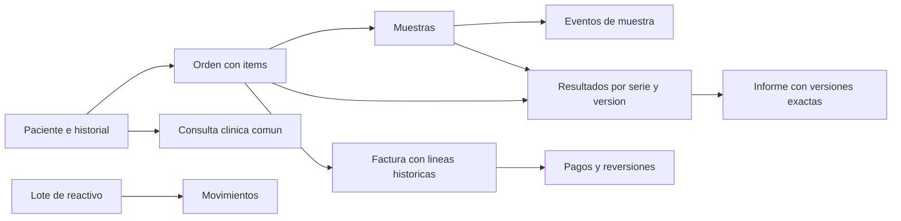

# Análisis e implementación del modelo MongoDB del laboratorio

Fecha: 19 de octubre de 2026. El script de inicialización es `Database/laboratorio_clinico_mongodb.js`. Crea **27 colecciones con validadores y 63 índices secundarios**, además de los índices `_id` propios de MongoDB. No carga pacientes, cuentas, contraseñas ni catálogos de demostración.

## 1. Fuentes y alcance

- Primera entrega, pp. 30–42: 22 colecciones principales y diez tipos de subdocumento; pp. 43–46: operaciones, versiones, pagos, reactivos y trazabilidad.
- Consigna final, pp. 3–4: aplicación con reglas equivalentes, modelo documental justificado y decisiones de consistencia/seguridad por motor.
- `Agente/DISENO_PROYECTO.md`, secciones 3.4, 5.3–5.7, 13 y 14: decisiones adoptadas y ampliaciones explícitas del modelo inicial.

Se implementa la **estructura de persistencia**, no la API ni los casos de uso. Los validadores verifican la forma y ciertas invariantes dentro de cada documento. Las reglas entre documentos, los estados anteriores, las autorizaciones y la inmutabilidad de datos emitidos necesitan el backend transaccional.

La base por defecto es `laboratorio_clinico`, exclusiva del laboratorio. `MONGO_LAB_DB` permite seleccionar otra base de desarrollo/prueba. Se rechazan los nombres `admin`, `local` y `config`; la inicialización requiere MongoDB 8.0+ y un replica set o clúster compatible con transacciones.

## 2. Decisiones del modelo documental

Un paciente acumula órdenes, muestras, resultados e informes durante años. Por eso se guardan como documentos independientes, referenciados por identificadores estables; el perfil no contiene una lista creciente de todos sus exámenes. Los datos que se consultan como una unidad de trabajo y tienen tamaño acotado se embeben.



| Se embebe | Justificación | Se referencia por separado |
|---|---|---|
| Contactos y cabecera del historial | Lectura conjunta con perfil; son pequeños y acotados. | Órdenes, consultas y eventos del paciente. |
| Parámetros de prueba | Definen una versión concreta de la prueba. | Método versionado y tipos de muestra reutilizados. |
| Ítems de orden | Se crean/consultan junto a la orden; conservan precio acordado. | Paciente, solicitante, prueba/versiones y muestras. |
| Rectificación dentro de evento de muestra | Actor, motivo y valores pertenecen al mismo evento. | Eventos separados para no hacer crecer un arreglo de la muestra. |
| Componentes y procedencia histórica del resultado | Tienen significado dentro de esa versión del análisis. | Muestras originales, prueba, analista, equipo y validador. |
| Cabecera de informe | Conserva los datos identificativos utilizados al emitir. | Identificadores de versiones exactas de resultados. |
| Receptor y líneas de factura | Preservan cómo se emitió, sin consultar precios actuales. | Pagos independientes y orden. |
| Mediciones de control de calidad | Conservan valores, objetivos y límites aplicados. | Equipo, prueba y operador. |
| Diagnósticos, tratamientos y receta de consulta clínica | Lectura y actualización del agregado de atención. | Paciente, cita, profesional y revisiones anteriores. |

Los diez subdocumentos iniciales se conservan en sus ubicaciones: `Contacto_Paciente` en `pacientes.contactos`; `Parametro_Prueba` en `pruebas.parametros`; `Item_Orden` en `ordenes.items`; `Rectificacion_Muestra` en `eventos_muestra.rectificacion`; `Procedencia_Muestra` y `Componente_Resultado` en `resultados`; `Cabecera_Informe` en `informes.cabecera`; `Medicion_Control` en `controles_calidad.mediciones`; `Receptor_Factura` y `Linea_Factura` en `facturas`. No se convierten automáticamente en diez colecciones adicionales.

## 3. Inventario de colecciones y restricciones

El script declara todos los atributos iniciales, salvo la sustitución explícita de contraseña local por identidad Firebase. La columna siguiente resume los campos principales; los `required` de cada validador son el diccionario ejecutable completo.

| Colección | Contenido principal y referencias | Restricciones / índices relevantes |
|---|---|---|
| `pacientes` | Identificación, nombres, nacimiento, contactos, `nombre_busqueda`, registro, activo y cabecera `historial`. | Código, identidad tipo/número e ID/número de historial únicos; ambas partes de identificación juntas o ausentes; activo coherente con historial. |
| `solicitantes` | Médico individual o institución; colegiación, contacto y estado. | Un solicitante MEDICO exige colegiación; combinación entidad/número única entre médicos. |
| `tipos_muestra` | Código, nombre, recipiente y conservación. | Código único. |
| `metodos` | Código, versión, nombre, descripción y activo. | `(codigo, version)` único; el ID identifica una versión exacta. |
| `pruebas` | Código/versión, área, método, muestras admisibles y parámetros. | Código/versión único; parámetros sin ID/código repetido dentro de la prueba; lista de tipos de muestra sin duplicados. |
| `ordenes` | Paciente, solicitante, actor, fecha, prioridad, moneda e ítems. | Número único; mínimo un ítem; `item_id` único dentro de la orden; cancelación con motivo. Índices por paciente/fecha y estado/fecha. |
| `muestras` | Barras, orden/ítems, tipo, toma/recepción, responsables y condición. | Barras únicas; recepción no anterior a toma; estados posteriores a toma exigen recepción; rechazo con motivo. |
| `eventos_muestra` | Muestra, evento, fecha, actor, ubicación y detalle/rectificación. | Rectificación exige campo, valores anterior/nuevo y motivo. Índice muestra/fecha. |
| `resultados` | Serie/versión, orden/ítem/prueba, procedencia, componentes, equipo/analista y validación. | Serie/versión única; valor numérico o textual, no ambos; componentes sin parámetros repetidos; validado con actor/fecha; corrección enlazada al anterior. |
| `informes` | Serie/versión, orden, IDs exactos de resultados, cabecera y archivo. | Serie/versión única; emisión con resultados, cabecera, fecha, actor, URI y SHA-256; nuevas versiones enlazan original y motivo. |
| `equipos` | Código, marca/modelo/serie, ubicación, alta y estado. | Código y número de serie presente únicos. |
| `proveedores` | Identificación y contacto del proveedor. | Tipo/número de identificación únicos. |
| `reactivos` | Código, nombre, fabricante, unidad y almacenamiento. | Código único. |
| `lotes_reactivo` | Reactivo, lote, vencimiento, estado y `revision_stock`. | Reactivo/lote único; revisión de stock entera no negativa. No guarda saldo como segunda fuente de verdad. |
| `movimientos_reactivo` | Lote, proveedor, tipo, cantidad, unidad, actor y resultado/control relacionado. | Cantidad Decimal128 positiva; clave de idempotencia única por actor; índice lote/fecha. |
| `controles_calidad` | Prueba, equipo, operador y mediciones con objetivos/límites aplicados. | Mediciones sin parámetro repetido; índices prueba/fecha y equipo/fecha. |
| `personal` | Nombres, cargo, colegiación, contacto y activo. | Colegiación presente exige entidad/número juntos y únicos. |
| `usuarios` | `auth_uid`, proveedor, institución, roles, estado y vínculos a personal/médico. | UID y nombre de usuario únicos; proveedor FIREBASE e institución LABORATORIO_CLINICO; se rechaza `contrasena_hash`. |
| `roles` | Nombre, descripción y permisos de aplicación. | Nombre único; permisos sin duplicados. No son cuentas/roles de infraestructura MongoDB. |
| `auditoria` | Actor interno/UID, institución, fecha, acción, recurso, correlación y detalle protegido. | Índices por recurso/fecha, actor/fecha y correlación. La inmutabilidad se aplica con permisos de infraestructura/backend. |
| `facturas` | Orden, receptor, moneda, líneas históricas y revisión de cobro. | Número único; mínimo una línea; IDs de línea únicos; emitir exige actor/fecha y anular exige motivo. |
| `pagos` | Factura, fecha, importe/moneda, método, clave, actor y reversión. | Importe Long positivo; clave única por actor; pago anulado exige reversión con fecha/actor/motivo. |
| `citas` | Paciente, médico solicitante individual, gestor, fecha, motivo y estado. | Cancelación con motivo; índices profesional/fecha, paciente/fecha y estado/fecha. |
| `consultas_clinicas` | Paciente/historial, médico, cita opcional, atención, diagnósticos, tratamientos y receta. | Una consulta por cita presente; receta lógica única; si hay diagnósticos debe haber uno principal; índices paciente/historial y fecha. |
| `operaciones` | Ámbito institucional/actor/caso/clave, hash de entrada, resultado y respuesta original. | Ámbito/clave único; sin TTL; respuesta confirmada en la misma transacción para repetir exactamente el resultado original. |
| `identidades_paciente` | Reserva de identificación normalizada y paciente propietario. | Tipo/número únicos; no crear reservas para pacientes sin documento. |
| `revisiones` | Recurso/versión, actor/fecha/motivo e instantánea anterior protegida. | Recurso/versión únicos; historial separado del documento vigente. |

**Procedencia de las ampliaciones:** las primeras 22 filas corresponden a Entrega I. `citas` y `consultas_clinicas` implementan la ampliación adoptada del núcleo clínico común, no funciones atribuidas al modelo original de laboratorio. `operaciones`, `identidades_paciente` y `revisiones` son auxiliares técnicos. Un analista no recibe facultad de emitir diagnósticos/recetas por existir estas colecciones; esas acciones requieren cuenta de médico individual autorizado y validación del backend.

## 4. Tipos, campos comunes y representación

- Todos los documentos tienen `_id` explícito y `revision` entera positiva para el control de concurrencia. Los recursos clínicos usan UUID canónico en minúsculas como texto, igual que la API. Las reservas técnicas de identidad/operación permiten `_id` textual hasta 240 caracteres; sus claves únicas de negocio determinan la reserva.
- `version` de método/prueba/resultado/informe/receta identifica una versión clínica; `revision` identifica la versión de escritura del documento. `revision_stock` y `revision_cobro` serializan las decisiones sobre saldo. No intercambiar estos contadores.
- Las referencias son UUID textuales, no ObjectId mezclados con strings. La existencia del documento referenciado se verifica en la aplicación. Métodos/pruebas y resultados versionados tienen nuevo `_id` por versión, conservando código/serie y número de versión.
- Los campos opcionales se omiten cuando se desconocen; no se reemplazan por `null` o cadenas vacías. Un índice parcial de identificación/serie/vínculo solo incluye documentos que contienen el dato esperado; dos pacientes sin identificación no compiten por una falsa clave vacía.
- `nombre_busqueda`, identificación, códigos y nombres de usuario deben normalizarse en la aplicación antes de insertar. El validador verifica tipos y presencia, pero no deduce equivalencia entre nombres o documentos escritos de formas distintas.
- Fechas de evento se guardan como BSON Date UTC. La fecha civil de nacimiento se codifica a medianoche UTC y el adaptador la devuelve como `YYYY-MM-DD`, sin desplazarla al convertir la zona horaria de la interfaz.
- Importes/precios/descuentos/impuestos son BSON Long en unidades monetarias menores: `NumberLong('1250')` representa 12.50 en una moneda de dos decimales. `moneda` identifica el código de tres letras mayúsculas; el backend valida monedas admitidas y su escala. No se aceptan importes Double.
- Las cantidades de reactivo usan Decimal128 (`NumberDecimal('1.25')`) para permitir fracciones exactas; las cantidades de servicios de factura son enteras positivas. Las mediciones pueden ser numéricas o textuales según la versión de prueba. El backend rechaza NaN/infinito y valida unidades, intervalos y opciones de cada parámetro.
- Cada documento se limita a **256 KiB BSON**, incluidos metadatos y envoltorios de respuesta/revisión; las listas de agregado tienen máximo 100 elementos. El backend debe medir el documento completo antes de escribir, reservando espacio para snapshots/respuestas; no basta medir solo el cuerpo recibido. No se truncan datos. El mismo ID dentro de una lista no puede reutilizarse cambiando otros campos cuando existe la regla correspondiente.
- `additionalProperties: false` detecta campos mal escritos y evita guardar contraseñas locales no definidas. Se permiten objetos flexibles únicamente en detalles protegidos de auditoría, imágenes anteriores y datos de respuesta idempotente; igualmente están sujetos al límite BSON y a autorización.

## 5. Reglas cubiertas por MongoDB y reglas de aplicación

| Regla | Garantía de esta entrega | Trabajo de backend pendiente |
|---|---|---|
| Estructura, tipos, requeridos y estados admitidos | Validadores strict/error. | Traducir errores a contrato API y validar antes de intentar escribir. |
| Identidades, códigos, versiones y claves repetidas | Índices únicos; reservas de identidad e idempotencia. | Normalizar; reservar en la misma transacción; comparar hash al reintentar; devolver respuesta original o conflicto. |
| Relación paciente → orden → muestra → resultado | Tipos de referencia, pero no foreign keys. | Comprobar existencia, pertenencia, estado y versión de todos los recursos dentro de la unidad de trabajo. |
| Emisión de informe | Se exige resultado(s) y metadatos del archivo cuando estado es EMITIDO. | Comprobar que todos los resultados estén VALIDADOS y sean de la misma orden/paciente; verificar el archivo y el hash antes de publicar. |
| Resultado validado, factura/receta emitida | Versiones y lugares donde conservar revisiones. | Impedir sobrescritura; crear nueva revisión con actor/motivo; proteger colecciones append-only mediante privilegios. |
| Cambio de estado | El estado final debe pertenecer al catálogo y tener sus campos requeridos. | Validar transición desde estado anterior: un enum no impide pasar arbitrariamente entre valores válidos. |
| Archivo de paciente | Cabecera, causa y coherencia activo/archivado. | Impedir nuevas atenciones/órdenes sobre archivado; permitir procesos iniciados/correcciones autorizadas según el diseño. |
| Pago y existencia de reactivo | Tipos positivos, claves únicas y contadores disponibles. | Calcular saldos dentro de transacción, forzar conflicto y reintentar; un índice no impide por sí solo sobrepago o stock negativo. |
| Institución, rol y profesional | Campos para identidad/cuenta/actor. | Verificar Firebase, cuenta activa, roles vigentes y permiso sobre operación/recurso. La colección `usuarios` no autentica conexiones MongoDB. |
| Tamaño y listas | Límite BSON y máximo de elementos en colecciones definidas. | Traducir a `LIMITE_AGREGADO` y planificar división/versiones sin perder datos. |

### Unidades de trabajo necesarias

1. **Alta de paciente:** comprobar identidad; crear paciente/historial, reserva si hay documento, operación idempotente y auditoría; commit conjunto.
2. **Consulta completa:** verificar paciente activo y profesional; crear consulta con diagnósticos/tratamientos/receta, atender cita si existe, guardar operación/respuesta y auditoría; rollback íntegro si falla cualquiera.
3. **Pago:** leer factura/estado/moneda, sumar pagos confirmados y calcular saldo; rechazar sobrepago; escribir `revision_cobro` y el nuevo pago/operación/auditoría en la misma transacción. Dos pagos concurrentes sobre la misma factura deben competir por esa revisión y recalcular al reintentar.
4. **Movimiento de reactivo:** leer lote, unidad, vigencia/estado y movimientos confirmados; calcular disponible; modificar `revision_stock` y crear movimiento/operación/auditoría juntos. Dos consumos concurrentes deben competir por la revisión del lote. Una retoma o repetición no reutiliza la clave de un consumo ya confirmado.
5. **Corrección de resultado:** verificar versión vigente y motivo; crear otro documento con la misma serie y versión consecutiva; conservar resultado anterior y registrar actor/auditoría/operación. Una repetición completa usa otra serie. Una colisión del índice de serie/versión genera conflicto, no sobrescritura.

`total_factura = Σ(cantidad × precio_unitario − descuento_importe + impuesto_importe)`; `saldo = total_factura − Σ(pagos confirmados no anulados)`; `disponible = entradas + ajustes_entrada − consumos − ajustes_salida − bajas`. Calcular importes con enteros/BigInt y comprobar rango BSON Long antes de persistir; rechazar descuentos que excedan el subtotal, monedas distintas y cantidades inválidas. Los saldos no se guardan como una segunda fuente de verdad. Las cantidades de inventario se operan con aritmética decimal, no convirtiéndolas a Double.

Las transacciones pueden reintentarse; no generar archivos ni producir efectos externos dentro del callback. La generación de informe y la provisión Firebase usan estados pendientes y confirmación posterior según el diseño, sin prometer transacción distribuida.

## 6. Ejecución de la inicialización

Desde la raíz del repositorio, sobre un replica set de desarrollo ya configurado:

```bash
mongosh 'mongodb://127.0.0.1:27017/?replicaSet=rs0' --norc --file Database/laboratorio_clinico_mongodb.js
```

Para seleccionar otra base:

```bash
MONGO_LAB_DB=laboratorio_clinico_desarrollo mongosh 'mongodb://127.0.0.1:27017/?replicaSet=rs0' --norc --file Database/laboratorio_clinico_mongodb.js
```

La URI anterior es un ejemplo local; usar la conexión real del replica set/Atlas correspondiente y credenciales de un usuario de inicialización mediante un mecanismo seguro. El script no crea usuarios de MongoDB, no configura el replica set, no lee `.env` automáticamente y no utiliza credenciales reales del repositorio. La cuenta de inicialización necesita crear colecciones/índices; la cuenta ordinaria de aplicación debe tener permisos menores y no `bypassDocumentValidation`.

### Desarrollo local aislado, si todavía no hay replica set

Con `mongod` y `mongosh` instalados, crear una instancia nueva en un directorio temporal y un puerto libre (el ejemplo usa 27018):

```bash
LAB_MONGO_DIR=$(mktemp -d /tmp/laboratorio_mongo.XXXXXX)
mongod --dbpath "$LAB_MONGO_DIR" --bind_ip 127.0.0.1 --port 27018 --replSet laboratorioRS --nounixsocket --fork --logpath "$LAB_MONGO_DIR/mongod.log"
mongosh 'mongodb://127.0.0.1:27018/admin?directConnection=true' --norc --eval 'rs.initiate({_id:"laboratorioRS",members:[{_id:0,host:"127.0.0.1:27018"}]})'
```

Esperar a que el miembro sea PRIMARY antes de ejecutar inicialización/pruebas:

```bash
mongosh 'mongodb://127.0.0.1:27018/?replicaSet=laboratorioRS' --norc --file Database/laboratorio_clinico_mongodb.js
```

Este ejemplo temporal escucha solo en loopback y no configura autenticación; su finalidad es desarrollo aislado. Detener esa instancia al terminar:

```bash
mongosh 'mongodb://127.0.0.1:27018/admin?directConnection=true' --norc --eval 'db.adminCommand({shutdown:1})'
```

### Reejecución y bases existentes

- Antes de crear nada se comparan validadores, nivel/acción de validación y los índices esperados de **todas** las colecciones que ya existan.
- Si una colección existente tiene otra estructura, una colación de colección incompatible o un índice esperado con opciones distintas, se detiene sin reemplazarla. Una base de un modelo anterior requiere migración explícita. No se usa `collMod` ni se eliminan índices para forzar compatibilidad.
- Si la estructura coincide, se conserva la información y se crean solo colecciones/índices faltantes. Los índices adicionales ajenos al script se conservan; su idoneidad no se certifica automáticamente.
- La inicialización DDL completa no es una única transacción: un corte, conflicto de creación concurrente o falta de permisos durante la ejecución puede dejar parte de la estructura creada. Corregir la causa y reejecutar sobre estructura compatible; no borrar la base para recuperarse.
- Los validadores no auditan retrospectivamente escrituras hechas con bypass. No se recomienda habilitar bypass para solucionar documentos inválidos; convertirlos mediante una migración revisada.

## 7. Pruebas reproducibles y resultado

Script: `Database/tests/laboratorio_clinico_mongodb.test.js`. Ejecutarlo desde la raíz conectado a un **replica set de pruebas**:

```bash
mongosh 'mongodb://127.0.0.1:27018/?replicaSet=laboratorioRS' --norc --file Database/tests/laboratorio_clinico_mongodb.test.js
```

Genera nombres únicos `laboratorio_clinico_test_*`, exige que las bases estén vacías antes de comenzar y elimina únicamente esas bases de prueba al terminar. No utiliza ni modifica `laboratorio_clinico`. Si se proporciona `MONGO_LAB_DB`, debe tener ese prefijo y no superar la longitud admitida por la prueba. La prueba también rechaza una base que ya tenga colecciones para no reutilizar datos anteriores.

Resultado verificado: **102 comprobaciones PASS** en una instancia temporal local con **MongoDB 8.0.32, mongosh 2.11.1**, replica set de un miembro. No se probó contra una base compartida o remota. El conjunto comprueba:

- 27 colecciones, validación estricta y 63 índices secundarios.
- Inserción de un documento sintético válido y rechazo de un campo requerido ausente en cada colección.
- Reejecución sin pérdida de documentos ni cambios de definición.
- Unicidad de identidad/códigos/series/versiones/operaciones/cita/receta y revisiones seleccionadas.
- Rechazos por UUID, tipos, estados, moneda, campos extra, valores negativos, falta de metadatos, duplicación de ítem dentro del mismo agregado, falta de diagnóstico principal, listas excesivas y documento BSON superior a 256 KiB.
- Aceptación de resultados numéricos y textuales, resultado validado con actor/fecha, informe con metadatos completos y expediente archivado con causa.
- Índices parciales que permiten varios pacientes sin documento y consultas sin cita.
- Rollback real de una transacción multi-documento ante un fallo de validación.
- Rechazo de esquema e índice incompatibles sin sobrescribirlos.
- Comprobación explícita del límite del validador: modificar un documento a otra forma válida no demuestra inmutabilidad histórica ni autorización del flujo. Esas garantías siguen pendientes en el backend.

No se afirma que estén probados los flujos clínicos CA01–CA20, la concurrencia de pagos/inventario, autenticación Firebase ni controles de seguridad desplegados. El servidor de pruebas únicamente demuestra las restricciones estructurales y transaccionales indicadas.

## 8. Referencias oficiales

- [Validación mediante JSON Schema](https://www.mongodb.com/docs/manual/core/schema-validation/specify-json-schema/): tipos BSON, requeridos y reglas de estructura.
- [Validación mediante expresiones](https://www.mongodb.com/docs/manual/core/schema-validation/specify-query-expression-rules/): invariantes dentro de un documento.
- [Índices parciales](https://www.mongodb.com/docs/manual/core/index-partial/): unicidad para datos opcionales presentes.
- [Tamaño BSON](https://www.mongodb.com/docs/manual/reference/operator/aggregation/bsonsize/): límite aplicado al documento completo.
- [Requisitos transaccionales](https://www.mongodb.com/docs/manual/core/transactions-production-consideration/): replica set/clúster y límites que deben considerar los adaptadores.

## Validaciones de consultas clínicas

El validador de `consultas_clinicas` comprueba el intervalo de cada tratamiento cuando tiene ambas fechas, el prescriptor igual al médico de consulta y los IDs de medicamentos sin repetición. `tests/regresiones_mongodb.js` comprueba las fechas, el prescriptor y la unicidad de medicamentos, además de la suite de estructura. Una base inicializada con validadores anteriores requiere migración explícita: el preflight no los sobrescribe. Ver la [guía de inicialización y pruebas](README.md).
