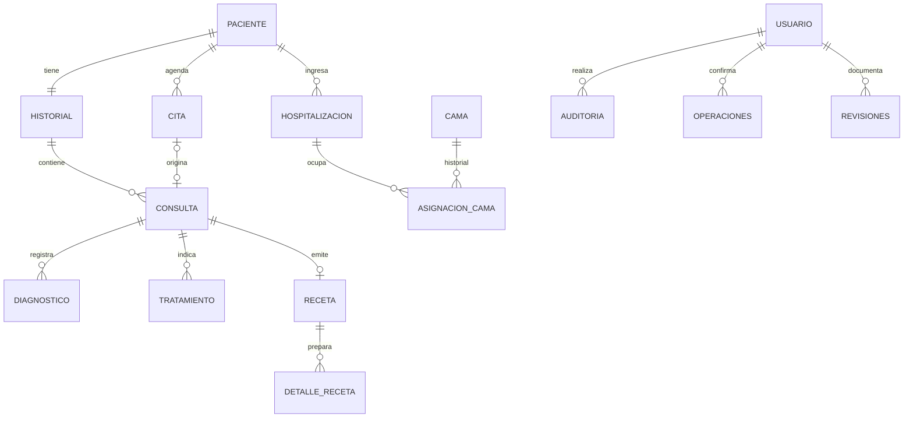

# Diccionario de los modelos SQL finales

Generado desde `information_schema.columns` de las instancias temporales verificadas. Contiene columnas, tipos, nulabilidad y defaults; las claves, checks, índices y triggers están en los inicializadores y se verifican mediante su manifiesto. No contiene registros clínicos.

Los UUID públicos y revisiones complementan las claves internas. Las instantáneas de recetas y las revisiones son copias históricas deliberadas, no una segunda fuente para administrar catálogos. Los diagramas siguientes resumen las relaciones centrales; las tablas de cada motor incluyen el resto del inventario.

El hospital relaciona diagnósticos directamente con consulta; odontología utiliza `consulta_diagnostico`. Hospitalización y cama son exclusivas de PostgreSQL. Las FK y restricciones de exclusión impiden los cruces y solapamientos descritos en el cierre.

## PostgreSQL: 50 tablas

### alergia

| Columna | Tipo | NULL | Default |
|---|---|---|---|
| id_publico | uuid | NO | gen_random_uuid() |
| revision | bigint | NO | 1 |
| id_alergia | bigint | NO | — |
| nombre | character varying | NO | — |
| descripcion | text | YES | — |

### antecedente_medico

| Columna | Tipo | NULL | Default |
|---|---|---|---|
| id_publico | uuid | NO | gen_random_uuid() |
| revision | bigint | NO | 1 |
| id_antecedente | bigint | NO | — |
| id_paciente | bigint | NO | — |
| tipo | character varying | NO | — |
| descripcion | text | NO | — |
| fecha_diagnostico | date | YES | — |
| observaciones | text | YES | — |

### aseguradora

| Columna | Tipo | NULL | Default |
|---|---|---|---|
| id_publico | uuid | NO | gen_random_uuid() |
| revision | bigint | NO | 1 |
| id_aseguradora | bigint | NO | — |
| nombre | character varying | NO | — |
| nit | character varying | YES | — |
| telefono | character varying | YES | — |
| correo | character varying | YES | — |
| direccion | text | YES | — |
| estado | character varying | NO | 'ACTIVA'::character varying |

### asignacion_cama

| Columna | Tipo | NULL | Default |
|---|---|---|---|
| id_publico | uuid | NO | gen_random_uuid() |
| revision | bigint | NO | 1 |
| id_asignacion | bigint | NO | — |
| id_hospitalizacion | bigint | NO | — |
| id_cama | bigint | NO | — |
| fecha_hora_inicio | timestamp without time zone | NO | — |
| fecha_hora_fin | timestamp without time zone | YES | — |

### auditoria

| Columna | Tipo | NULL | Default |
|---|---|---|---|
| id_publico | uuid | NO | gen_random_uuid() |
| revision | bigint | NO | 1 |
| id_auditoria | bigint | NO | — |
| id_usuario | bigint | YES | — |
| accion | character varying | NO | — |
| tabla_afectada | character varying | NO | — |
| registro_afectado | character varying | YES | — |
| fecha_hora | timestamp without time zone | NO | CURRENT_TIMESTAMP |
| detalle | text | YES | — |

### cama

| Columna | Tipo | NULL | Default |
|---|---|---|---|
| id_publico | uuid | NO | gen_random_uuid() |
| revision | bigint | NO | 1 |
| id_cama | bigint | NO | — |
| id_habitacion | bigint | NO | — |
| numero_cama | character varying | NO | — |
| estado_operativo | character varying | NO | 'DISPONIBLE'::character varying |

### catalogo_diagnostico

| Columna | Tipo | NULL | Default |
|---|---|---|---|
| id_publico | uuid | NO | gen_random_uuid() |
| revision | bigint | NO | 1 |
| id_catalogo_diagnostico | bigint | NO | — |
| sistema | character varying | YES | — |
| version | character varying | YES | — |
| codigo | character varying | NO | — |
| nombre | character varying | NO | — |
| descripcion | text | YES | — |

### cita

| Columna | Tipo | NULL | Default |
|---|---|---|---|
| id_publico | uuid | NO | gen_random_uuid() |
| revision | bigint | NO | 1 |
| id_cita | bigint | NO | — |
| id_paciente | bigint | NO | — |
| id_personal_programado | bigint | NO | — |
| fecha_hora_inicio | timestamp without time zone | NO | — |
| fecha_hora_fin | timestamp without time zone | YES | — |
| motivo_solicitud | text | NO | — |
| estado_cita | character varying | NO | 'PROGRAMADA'::character varying |
| observaciones | text | YES | — |

### consulta

| Columna | Tipo | NULL | Default |
|---|---|---|---|
| id_publico | uuid | NO | gen_random_uuid() |
| revision | bigint | NO | 1 |
| id_consulta | bigint | NO | — |
| id_historial | bigint | NO | — |
| id_personal_atendio | bigint | NO | — |
| id_cita | bigint | YES | — |
| fecha_hora | timestamp without time zone | NO | CURRENT_TIMESTAMP |
| motivo_consulta | text | NO | — |
| sintomas | text | YES | — |
| observaciones | text | YES | — |
| notas_medicas | text | YES | — |
| estado | character varying | NO | 'ABIERTA'::character varying |

### contacto_emergencia

| Columna | Tipo | NULL | Default |
|---|---|---|---|
| id_publico | uuid | NO | gen_random_uuid() |
| revision | bigint | NO | 1 |
| id_contacto | bigint | NO | — |
| id_paciente | bigint | NO | — |
| primer_nombre | character varying | NO | — |
| segundo_nombre | character varying | YES | — |
| primer_apellido | character varying | NO | — |
| segundo_apellido | character varying | YES | — |
| parentesco | character varying | NO | — |
| telefono | character varying | NO | — |

### detalle_orden_examen

| Columna | Tipo | NULL | Default |
|---|---|---|---|
| id_publico | uuid | NO | gen_random_uuid() |
| revision | bigint | NO | 1 |
| id_detalle_orden | bigint | NO | — |
| id_orden | bigint | NO | — |
| id_examen | bigint | NO | — |
| indicaciones_muestra | text | YES | — |

### detalle_receta

| Columna | Tipo | NULL | Default |
|---|---|---|---|
| id_publico | uuid | NO | gen_random_uuid() |
| revision | bigint | NO | 1 |
| id_detalle_receta | bigint | NO | — |
| id_receta | bigint | NO | — |
| id_medicamento | bigint | NO | — |
| dosis_cantidad | numeric | YES | — |
| id_unidad_dosis | bigint | YES | — |
| frecuencia | character varying | YES | — |
| duracion_dias | integer | YES | — |
| via_administracion | character varying | YES | — |
| instrucciones | text | YES | — |

### diagnostico

| Columna | Tipo | NULL | Default |
|---|---|---|---|
| id_publico | uuid | NO | gen_random_uuid() |
| revision | bigint | NO | 1 |
| id_diagnostico | bigint | NO | — |
| id_consulta | bigint | NO | — |
| id_catalogo_diagnostico | bigint | NO | — |
| tipo | character varying | YES | — |
| es_principal | boolean | NO | false |
| fecha_diagnostico | date | NO | CURRENT_DATE |
| estado | character varying | NO | 'ACTIVO'::character varying |

### diagnostico_tratamiento

| Columna | Tipo | NULL | Default |
|---|---|---|---|
| id_publico | uuid | NO | gen_random_uuid() |
| revision | bigint | NO | 1 |
| id_diagnostico | bigint | NO | — |
| id_tratamiento | bigint | NO | — |

### especialidad

| Columna | Tipo | NULL | Default |
|---|---|---|---|
| id_publico | uuid | NO | gen_random_uuid() |
| revision | bigint | NO | 1 |
| id_especialidad | bigint | NO | — |
| nombre | character varying | NO | — |
| descripcion | text | YES | — |

### examen_medico

| Columna | Tipo | NULL | Default |
|---|---|---|---|
| id_publico | uuid | NO | gen_random_uuid() |
| revision | bigint | NO | 1 |
| id_examen | bigint | NO | — |
| nombre | character varying | NO | — |
| descripcion | text | YES | — |
| tipo | character varying | YES | — |

### habitacion

| Columna | Tipo | NULL | Default |
|---|---|---|---|
| id_publico | uuid | NO | gen_random_uuid() |
| revision | bigint | NO | 1 |
| id_habitacion | bigint | NO | — |
| numero | character varying | NO | — |
| piso | character varying | YES | — |
| tipo | character varying | YES | — |
| estado_operativo | character varying | NO | 'DISPONIBLE'::character varying |

### historial_clinico

| Columna | Tipo | NULL | Default |
|---|---|---|---|
| causa_baja | character varying | YES | — |
| motivo_baja | text | YES | — |
| fecha_baja | timestamp without time zone | YES | — |
| actor_baja | uuid | YES | — |
| id_publico | uuid | NO | gen_random_uuid() |
| revision | bigint | NO | 1 |
| id_historial | bigint | NO | — |
| id_paciente | bigint | NO | — |
| numero_historial | character varying | NO | — |
| fecha_apertura | date | NO | CURRENT_DATE |
| observaciones_generales | text | YES | — |
| estado_historial | character varying | NO | 'ACTIVO'::character varying |

### hospitalizacion

| Columna | Tipo | NULL | Default |
|---|---|---|---|
| id_publico | uuid | NO | gen_random_uuid() |
| revision | bigint | NO | 1 |
| id_hospitalizacion | bigint | NO | — |
| id_paciente | bigint | NO | — |
| id_personal_responsable_ingreso | bigint | NO | — |
| fecha_ingreso | timestamp without time zone | NO | — |
| fecha_egreso | timestamp without time zone | YES | — |
| motivo_ingreso | text | NO | — |
| observaciones | text | YES | — |
| estado | character varying | NO | 'ACTIVA'::character varying |

### hospitalizacion_consulta

| Columna | Tipo | NULL | Default |
|---|---|---|---|
| id_publico | uuid | NO | gen_random_uuid() |
| revision | bigint | NO | 1 |
| id_consulta | bigint | NO | — |
| id_hospitalizacion | bigint | NO | — |

### hospitalizacion_diagnostico

| Columna | Tipo | NULL | Default |
|---|---|---|---|
| id_publico | uuid | NO | gen_random_uuid() |
| revision | bigint | NO | 1 |
| id_hospitalizacion_diagnostico | bigint | NO | — |
| id_hospitalizacion | bigint | NO | — |
| id_diagnostico | bigint | NO | — |
| tipo_en_hospitalizacion | character varying | YES | — |
| fecha_vinculacion | date | NO | CURRENT_DATE |
| observaciones | text | YES | — |

### identidades_paciente

| Columna | Tipo | NULL | Default |
|---|---|---|---|
| clave | character | NO | — |
| tipo_documento | character varying | NO | — |
| numero_documento | character varying | NO | — |
| id_paciente | bigint | NO | — |
| fecha_registro | timestamp without time zone | NO | CURRENT_TIMESTAMP |

### laboratorio_farmaceutico

| Columna | Tipo | NULL | Default |
|---|---|---|---|
| id_publico | uuid | NO | gen_random_uuid() |
| revision | bigint | NO | 1 |
| id_laboratorio | bigint | NO | — |
| nombre | character varying | NO | — |

### medicamento

| Columna | Tipo | NULL | Default |
|---|---|---|---|
| id_publico | uuid | NO | gen_random_uuid() |
| revision | bigint | NO | 1 |
| id_medicamento | bigint | NO | — |
| nombre | character varying | NO | — |
| presentacion | character varying | YES | — |
| id_laboratorio | bigint | YES | — |
| cantidad_base | numeric | YES | — |
| id_unidad_base | bigint | YES | — |
| descripcion | text | YES | — |

### medicamento_principio_activo

| Columna | Tipo | NULL | Default |
|---|---|---|---|
| id_publico | uuid | NO | gen_random_uuid() |
| revision | bigint | NO | 1 |
| id_medicamento | bigint | NO | — |
| id_principio_activo | bigint | NO | — |
| cantidad | numeric | YES | — |
| id_unidad_cantidad | bigint | YES | — |

### modelo_database

| Columna | Tipo | NULL | Default |
|---|---|---|---|
| id | smallint | NO | — |
| version | integer | NO | — |
| huella | text | NO | — |
| fecha_creacion | timestamp with time zone | NO | CURRENT_TIMESTAMP |

### operaciones

| Columna | Tipo | NULL | Default |
|---|---|---|---|
| id_operacion | uuid | NO | — |
| id_usuario | bigint | NO | — |
| caso_uso | character varying | NO | — |
| clave | character varying | NO | — |
| hash_entrada | character | NO | — |
| codigo_respuesta | integer | NO | — |
| respuesta | jsonb | NO | — |
| fecha_hora | timestamp without time zone | NO | CURRENT_TIMESTAMP |

### orden_examen

| Columna | Tipo | NULL | Default |
|---|---|---|---|
| id_publico | uuid | NO | gen_random_uuid() |
| revision | bigint | NO | 1 |
| id_orden | bigint | NO | — |
| id_consulta | bigint | NO | — |
| id_personal_solicitante | bigint | NO | — |
| fecha_solicitud | timestamp without time zone | NO | CURRENT_TIMESTAMP |
| indicaciones | text | YES | — |
| estado | character varying | NO | 'SOLICITADA'::character varying |

### paciente

| Columna | Tipo | NULL | Default |
|---|---|---|---|
| id_publico | uuid | NO | gen_random_uuid() |
| revision | bigint | NO | 1 |
| id_paciente | bigint | NO | — |
| cui | character varying | YES | — |
| primer_nombre | character varying | NO | — |
| segundo_nombre | character varying | YES | — |
| primer_apellido | character varying | NO | — |
| segundo_apellido | character varying | YES | — |
| fecha_nacimiento | date | YES | — |
| sexo | character varying | YES | — |
| tipo_sangre | character varying | YES | — |
| telefono_principal | character varying | YES | — |
| correo_principal | character varying | YES | — |
| direccion | text | YES | — |
| fecha_registro | timestamp without time zone | NO | CURRENT_TIMESTAMP |

### paciente_alergia

| Columna | Tipo | NULL | Default |
|---|---|---|---|
| id_publico | uuid | NO | gen_random_uuid() |
| revision | bigint | NO | 1 |
| id_paciente_alergia | bigint | NO | — |
| id_paciente | bigint | NO | — |
| id_alergia | bigint | NO | — |
| tipo_reaccion | text | YES | — |
| severidad | character varying | YES | — |
| observaciones | text | YES | — |
| fecha_registro | date | NO | CURRENT_DATE |

### paciente_poliza

| Columna | Tipo | NULL | Default |
|---|---|---|---|
| id_publico | uuid | NO | gen_random_uuid() |
| revision | bigint | NO | 1 |
| id_paciente_poliza | bigint | NO | — |
| id_paciente | bigint | NO | — |
| id_poliza | bigint | NO | — |
| numero_afiliado | character varying | YES | — |
| parentesco_titular | character varying | YES | — |
| fecha_inicio_cobertura | date | YES | — |
| fecha_fin_cobertura | date | YES | — |
| estado_afiliacion | character varying | NO | 'ACTIVA'::character varying |

### parametro_examen

| Columna | Tipo | NULL | Default |
|---|---|---|---|
| id_publico | uuid | NO | gen_random_uuid() |
| revision | bigint | NO | 1 |
| id_parametro | bigint | NO | — |
| nombre | character varying | NO | — |
| descripcion | text | YES | — |

### personal_especialidad

| Columna | Tipo | NULL | Default |
|---|---|---|---|
| id_publico | uuid | NO | gen_random_uuid() |
| revision | bigint | NO | 1 |
| id_personal | bigint | NO | — |
| id_especialidad | bigint | NO | — |

### personal_medico

| Columna | Tipo | NULL | Default |
|---|---|---|---|
| id_publico | uuid | NO | gen_random_uuid() |
| revision | bigint | NO | 1 |
| id_personal | bigint | NO | — |
| primer_nombre | character varying | NO | — |
| segundo_nombre | character varying | YES | — |
| primer_apellido | character varying | NO | — |
| segundo_apellido | character varying | YES | — |
| numero_colegiado | character varying | YES | — |
| entidad_colegiacion | character varying | YES | — |
| telefono_principal | character varying | YES | — |
| correo_principal | character varying | YES | — |
| estado | character varying | NO | 'ACTIVO'::character varying |

### plan_seguro

| Columna | Tipo | NULL | Default |
|---|---|---|---|
| id_publico | uuid | NO | gen_random_uuid() |
| revision | bigint | NO | 1 |
| id_plan | bigint | NO | — |
| id_aseguradora | bigint | NO | — |
| nombre_plan | character varying | NO | — |
| version_plan | character varying | YES | — |
| descripcion | text | YES | — |
| porcentaje_cobertura | numeric | YES | — |
| monto_maximo_cobertura | numeric | YES | — |
| moneda | character | YES | — |
| estado | character varying | NO | 'ACTIVO'::character varying |

### poliza

| Columna | Tipo | NULL | Default |
|---|---|---|---|
| id_publico | uuid | NO | gen_random_uuid() |
| revision | bigint | NO | 1 |
| id_poliza | bigint | NO | — |
| id_plan | bigint | NO | — |
| id_titular | bigint | NO | — |
| numero_poliza | character varying | NO | — |
| fecha_inicio | date | NO | — |
| fecha_vencimiento | date | YES | — |
| estado | character varying | NO | 'ACTIVA'::character varying |

### principio_activo

| Columna | Tipo | NULL | Default |
|---|---|---|---|
| id_publico | uuid | NO | gen_random_uuid() |
| revision | bigint | NO | 1 |
| id_principio_activo | bigint | NO | — |
| nombre | character varying | NO | — |
| descripcion | text | YES | — |

### procedimiento

| Columna | Tipo | NULL | Default |
|---|---|---|---|
| id_publico | uuid | NO | gen_random_uuid() |
| revision | bigint | NO | 1 |
| id_procedimiento | bigint | NO | — |
| nombre | character varying | NO | — |
| descripcion | text | YES | — |

### procedimiento_realizado

| Columna | Tipo | NULL | Default |
|---|---|---|---|
| id_publico | uuid | NO | gen_random_uuid() |
| revision | bigint | NO | 1 |
| id_procedimiento_realizado | bigint | NO | — |
| id_procedimiento | bigint | NO | — |
| id_consulta | bigint | NO | — |
| id_personal_responsable | bigint | NO | — |
| fecha_hora | timestamp without time zone | NO | CURRENT_TIMESTAMP |
| resultado | text | YES | — |
| observaciones | text | YES | — |

### receta

| Columna | Tipo | NULL | Default |
|---|---|---|---|
| estado | character varying | NO | 'BORRADOR'::character varying |
| contenido_historico | jsonb | YES | — |
| motivo_anulacion | text | YES | — |
| id_publico | uuid | NO | gen_random_uuid() |
| revision | bigint | NO | 1 |
| id_receta | bigint | NO | — |
| id_consulta | bigint | NO | — |
| id_personal_prescriptor | bigint | NO | — |
| fecha_hora | timestamp without time zone | NO | CURRENT_TIMESTAMP |
| indicaciones_generales | text | YES | — |

### resultado_detalle

| Columna | Tipo | NULL | Default |
|---|---|---|---|
| id_publico | uuid | NO | gen_random_uuid() |
| revision | bigint | NO | 1 |
| id_resultado_detalle | bigint | NO | — |
| id_resultado | bigint | NO | — |
| secuencia | integer | NO | — |
| id_parametro | bigint | NO | — |
| fecha_hora_medicion | timestamp without time zone | YES | — |
| valor_numerico | numeric | YES | — |
| valor_texto | text | YES | — |
| id_unidad | bigint | YES | — |
| referencia_inferior | numeric | YES | — |
| referencia_superior | numeric | YES | — |
| referencia_texto | text | YES | — |
| observaciones | text | YES | — |

### resultado_examen

| Columna | Tipo | NULL | Default |
|---|---|---|---|
| id_publico | uuid | NO | gen_random_uuid() |
| revision | bigint | NO | 1 |
| id_resultado | bigint | NO | — |
| id_detalle_orden | bigint | NO | — |
| version | integer | NO | 1 |
| fecha_resultado | timestamp without time zone | NO | CURRENT_TIMESTAMP |
| informe_texto | text | YES | — |
| observaciones | text | YES | — |
| archivo_resultado | text | YES | — |

### revisiones

| Columna | Tipo | NULL | Default |
|---|---|---|---|
| id_revision | uuid | NO | — |
| tipo_recurso | character varying | NO | — |
| recurso_id | uuid | NO | — |
| version | bigint | NO | — |
| id_usuario | bigint | NO | — |
| fecha_hora | timestamp without time zone | NO | CURRENT_TIMESTAMP |
| motivo | text | NO | — |
| contenido_anterior | jsonb | NO | — |

### rol

| Columna | Tipo | NULL | Default |
|---|---|---|---|
| id_publico | uuid | NO | gen_random_uuid() |
| revision | bigint | NO | 1 |
| id_rol | bigint | NO | — |
| nombre | character varying | NO | — |
| descripcion | text | YES | — |
| permisos | jsonb | NO | '[]'::jsonb |

### signos_vitales

| Columna | Tipo | NULL | Default |
|---|---|---|---|
| id_publico | uuid | NO | gen_random_uuid() |
| revision | bigint | NO | 1 |
| id_signos_vitales | bigint | NO | — |
| id_consulta | bigint | NO | — |
| fecha_hora_medicion | timestamp without time zone | NO | CURRENT_TIMESTAMP |
| peso_kg | numeric | YES | — |
| altura_cm | numeric | YES | — |
| temperatura_c | numeric | YES | — |
| presion_sistolica_mmhg | smallint | YES | — |
| presion_diastolica_mmhg | smallint | YES | — |
| frecuencia_cardiaca_lpm | smallint | YES | — |
| frecuencia_respiratoria_rpm | smallint | YES | — |
| saturacion_oxigeno_pct | numeric | YES | — |

### titular_seguro

| Columna | Tipo | NULL | Default |
|---|---|---|---|
| id_publico | uuid | NO | gen_random_uuid() |
| revision | bigint | NO | 1 |
| id_titular | bigint | NO | — |
| primer_nombre | character varying | NO | — |
| segundo_nombre | character varying | YES | — |
| primer_apellido | character varying | NO | — |
| segundo_apellido | character varying | YES | — |
| cui | character varying | YES | — |
| telefono | character varying | YES | — |

### tratamiento

| Columna | Tipo | NULL | Default |
|---|---|---|---|
| id_publico | uuid | NO | gen_random_uuid() |
| revision | bigint | NO | 1 |
| id_tratamiento | bigint | NO | — |
| id_consulta | bigint | NO | — |
| descripcion | text | NO | — |
| fecha_inicio | date | YES | — |
| fecha_fin | date | YES | — |
| indicaciones | text | YES | — |
| estado | character varying | NO | 'ACTIVO'::character varying |

### unidad_medida

| Columna | Tipo | NULL | Default |
|---|---|---|---|
| id_publico | uuid | NO | gen_random_uuid() |
| revision | bigint | NO | 1 |
| id_unidad | bigint | NO | — |
| codigo | character varying | NO | — |
| nombre | character varying | NO | — |
| dimension | character varying | YES | — |

### usuario

| Columna | Tipo | NULL | Default |
|---|---|---|---|
| id_publico | uuid | NO | gen_random_uuid() |
| revision | bigint | NO | 1 |
| id_usuario | bigint | NO | — |
| id_personal | bigint | YES | — |
| nombre_usuario | character varying | NO | — |
| auth_uid | character varying | NO | — |
| proveedor_identidad | character varying | NO | 'FIREBASE'::character varying |
| institucion_id | character varying | NO | 'HOSPITAL_GENERAL'::character varying |
| ultimo_acceso | timestamp without time zone | YES | — |
| estado | character varying | NO | 'ACTIVO'::character varying |

### usuario_rol

| Columna | Tipo | NULL | Default |
|---|---|---|---|
| id_publico | uuid | NO | gen_random_uuid() |
| revision | bigint | NO | 1 |
| id_usuario | bigint | NO | — |
| id_rol | bigint | NO | — |

## MySQL: 22 tablas

### antecedente

| Columna | Tipo | NULL | Default |
|---|---|---|---|
| id_publico | char(36) | NO | uuid() |
| revision | bigint unsigned | NO | 1 |
| id_antecedente | bigint unsigned | NO | — |
| id_historial | bigint unsigned | NO | — |
| tipo | varchar(100) | NO | — |
| descripcion | text | NO | — |
| fecha_registro | date | NO | curdate() |

### auditoria

| Columna | Tipo | NULL | Default |
|---|---|---|---|
| id_auditoria | bigint unsigned | NO | — |
| id_publico | char(36) | NO | uuid() |
| id_usuario | bigint unsigned | NO | — |
| accion | varchar(100) | NO | — |
| tabla_afectada | varchar(100) | NO | — |
| registro_afectado | varchar(120) | YES | — |
| fecha_hora | datetime | NO | CURRENT_TIMESTAMP |
| detalle | json | YES | — |

### cita

| Columna | Tipo | NULL | Default |
|---|---|---|---|
| id_publico | char(36) | NO | uuid() |
| revision | bigint unsigned | NO | 1 |
| id_cita | bigint unsigned | NO | — |
| id_paciente | bigint unsigned | NO | — |
| id_odontologo | bigint unsigned | NO | — |
| id_secretaria | bigint unsigned | NO | — |
| fecha_hora | datetime | NO | — |
| motivo | text | NO | — |
| estado | varchar(30) | NO | PROGRAMADA |
| fecha_creacion | datetime | NO | CURRENT_TIMESTAMP |

### consulta_diagnostico

| Columna | Tipo | NULL | Default |
|---|---|---|---|
| id_publico | char(36) | NO | uuid() |
| revision | bigint unsigned | NO | 1 |
| id_consulta | bigint unsigned | NO | — |
| id_diagnostico | bigint unsigned | NO | — |
| es_principal | tinyint(1) | NO | 0 |
| principal_consulta | bigint unsigned | YES | — |
| observaciones | text | YES | — |

### consulta_odontologica

| Columna | Tipo | NULL | Default |
|---|---|---|---|
| id_publico | char(36) | NO | uuid() |
| revision | bigint unsigned | NO | 1 |
| id_consulta | bigint unsigned | NO | — |
| id_historial | bigint unsigned | NO | — |
| id_cita | bigint unsigned | NO | — |
| id_odontologo | bigint unsigned | NO | — |
| fecha_hora | datetime | NO | CURRENT_TIMESTAMP |
| motivo | text | NO | — |
| observaciones | text | YES | — |
| estado | varchar(30) | NO | ABIERTA |

### consulta_tratamiento

| Columna | Tipo | NULL | Default |
|---|---|---|---|
| id_publico | char(36) | NO | uuid() |
| revision | bigint unsigned | NO | 1 |
| id_consulta | bigint unsigned | NO | — |
| id_tratamiento | bigint unsigned | NO | — |
| fecha_inicio | date | YES | — |
| fecha_fin | date | YES | — |
| observaciones | text | YES | — |

### detalle_receta

| Columna | Tipo | NULL | Default |
|---|---|---|---|
| id_publico | char(36) | NO | uuid() |
| revision | bigint unsigned | NO | 1 |
| id_receta | bigint unsigned | NO | — |
| id_medicamento | bigint unsigned | NO | — |
| dosis | varchar(120) | NO | — |
| frecuencia | varchar(120) | NO | — |
| duracion | varchar(120) | YES | — |
| via_administracion | varchar(100) | YES | — |
| indicaciones | text | YES | — |

### diagnostico

| Columna | Tipo | NULL | Default |
|---|---|---|---|
| id_publico | char(36) | NO | uuid() |
| revision | bigint unsigned | NO | 1 |
| id_diagnostico | bigint unsigned | NO | — |
| codigo | varchar(50) | NO | — |
| nombre | varchar(180) | NO | — |
| descripcion | text | YES | — |

### historial_clinico

| Columna | Tipo | NULL | Default |
|---|---|---|---|
| causa_baja | varchar(30) | YES | — |
| motivo_baja | text | YES | — |
| fecha_baja | datetime | YES | — |
| actor_baja | char(36) | YES | — |
| id_publico | char(36) | NO | uuid() |
| revision | bigint unsigned | NO | 1 |
| id_historial | bigint unsigned | NO | — |
| id_paciente | bigint unsigned | NO | — |
| fecha_apertura | date | NO | curdate() |
| estado | varchar(30) | NO | ACTIVO |
| motivo_cierre | text | YES | — |
| observaciones | text | YES | — |

### identidades_paciente

| Columna | Tipo | NULL | Default |
|---|---|---|---|
| clave | char(64) | NO | — |
| tipo_documento | varchar(40) | NO | — |
| numero_documento | varchar(80) | NO | — |
| id_paciente | bigint unsigned | NO | — |
| fecha_registro | datetime | NO | CURRENT_TIMESTAMP |

### medicamento

| Columna | Tipo | NULL | Default |
|---|---|---|---|
| id_publico | char(36) | NO | uuid() |
| revision | bigint unsigned | NO | 1 |
| id_medicamento | bigint unsigned | NO | — |
| nombre_generico | varchar(180) | NO | — |
| presentacion | varchar(150) | YES | — |
| concentracion | varchar(100) | YES | — |

### modelo_database

| Columna | Tipo | NULL | Default |
|---|---|---|---|
| id | smallint | NO | — |
| version | int | NO | — |
| huella | char(64) | NO | — |
| fecha_creacion | timestamp | NO | CURRENT_TIMESTAMP |

### odontologo

| Columna | Tipo | NULL | Default |
|---|---|---|---|
| id_publico | char(36) | NO | uuid() |
| revision | bigint unsigned | NO | 1 |
| id_odontologo | bigint unsigned | NO | — |
| nombres | varchar(160) | NO | — |
| apellidos | varchar(160) | NO | — |
| colegiado | varchar(50) | NO | — |
| telefono | varchar(30) | YES | — |
| correo | varchar(254) | YES | — |

### operaciones

| Columna | Tipo | NULL | Default |
|---|---|---|---|
| id_operacion | char(36) | NO | — |
| id_usuario | bigint unsigned | NO | — |
| caso_uso | varchar(100) | NO | — |
| clave | varchar(200) | NO | — |
| hash_entrada | char(64) | NO | — |
| codigo_respuesta | int | NO | — |
| respuesta | json | NO | — |
| fecha_hora | datetime | NO | CURRENT_TIMESTAMP |

### paciente

| Columna | Tipo | NULL | Default |
|---|---|---|---|
| id_publico | char(36) | NO | uuid() |
| revision | bigint unsigned | NO | 1 |
| id_paciente | bigint unsigned | NO | — |
| nombres | varchar(160) | NO | — |
| apellidos | varchar(160) | NO | — |
| fecha_nacimiento | date | YES | — |
| telefono | varchar(30) | YES | — |
| correo | varchar(254) | YES | — |
| estado | varchar(30) | NO | ACTIVO |

### receta

| Columna | Tipo | NULL | Default |
|---|---|---|---|
| estado | varchar(20) | NO | BORRADOR |
| contenido_historico | json | YES | — |
| motivo_anulacion | text | YES | — |
| id_publico | char(36) | NO | uuid() |
| revision | bigint unsigned | NO | 1 |
| id_receta | bigint unsigned | NO | — |
| id_consulta | bigint unsigned | NO | — |
| fecha_emision | datetime | NO | CURRENT_TIMESTAMP |

### revisiones

| Columna | Tipo | NULL | Default |
|---|---|---|---|
| id_revision | char(36) | NO | — |
| tipo_recurso | varchar(100) | NO | — |
| recurso_id | char(36) | NO | — |
| version | bigint | NO | — |
| id_usuario | bigint unsigned | NO | — |
| fecha_hora | datetime | NO | CURRENT_TIMESTAMP |
| motivo | text | NO | — |
| contenido_anterior | json | NO | — |

### rol

| Columna | Tipo | NULL | Default |
|---|---|---|---|
| id_rol | bigint unsigned | NO | — |
| id_publico | char(36) | NO | uuid() |
| revision | bigint unsigned | NO | 1 |
| nombre | varchar(80) | NO | — |
| descripcion | text | YES | — |
| permisos | json | NO | json_array() |

### secretaria

| Columna | Tipo | NULL | Default |
|---|---|---|---|
| id_publico | char(36) | NO | uuid() |
| revision | bigint unsigned | NO | 1 |
| id_secretaria | bigint unsigned | NO | — |
| nombres | varchar(160) | NO | — |
| apellidos | varchar(160) | NO | — |
| telefono | varchar(30) | YES | — |
| correo | varchar(254) | YES | — |

### tratamiento

| Columna | Tipo | NULL | Default |
|---|---|---|---|
| id_publico | char(36) | NO | uuid() |
| revision | bigint unsigned | NO | 1 |
| id_tratamiento | bigint unsigned | NO | — |
| nombre | varchar(180) | NO | — |
| descripcion | text | YES | — |

### usuario

| Columna | Tipo | NULL | Default |
|---|---|---|---|
| id_usuario | bigint unsigned | NO | — |
| id_publico | char(36) | NO | uuid() |
| revision | bigint unsigned | NO | 1 |
| auth_uid | varchar(128) | NO | — |
| proveedor_identidad | varchar(20) | NO | FIREBASE |
| institucion_id | varchar(40) | NO | CLINICA_ODONTOLOGICA |
| nombre_usuario | varchar(80) | NO | — |
| id_odontologo | bigint unsigned | YES | — |
| id_secretaria | bigint unsigned | YES | — |
| estado | varchar(30) | NO | PENDIENTE |
| ultimo_acceso | datetime | YES | — |

### usuario_rol

| Columna | Tipo | NULL | Default |
|---|---|---|---|
| id_usuario | bigint unsigned | NO | — |
| id_rol | bigint unsigned | NO | — |
