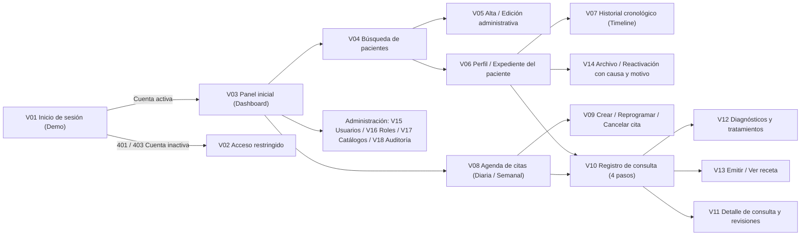

# 06 — Plan de Vistas Comunes (`V01` a `V19`)

**Fecha:** 19 de octubre de 2026  
**Cobertura:** 19 entradas del núcleo común compartido por las cuatro instituciones.

---

## 1. Flujo de usuario del núcleo común

---

## 2. Especificación detallada por entrada (`V01`–`V19`)

### `V01` — Inicio de sesión (Modo demostración)
- **Superficie:** Ruta `/acceso`.
- **Propósito:** Autenticar una sesión de demostración seleccionando explícitamente una cuenta sintética vinculada a una única institución, o probar el formulario de credenciales institucionales y los escenarios de fallo (`401`, `403`, `503`).
- **Reglas críticas:**
  - Etiqueta visible y permanente: **«Modo demostración — sin autenticación real · Datos clínicos ficticios»**.
  - **Sin selector de motor de base de datos:** el usuario elige una cuenta institucional (o filtra el catálogo de cuentas de prueba por institución para facilitar la evaluación académica), y el vínculo de la cuenta fija la institución durante toda la sesión.
  - Una vez iniciada la sesión, no se puede cambiar de institución sin cerrar la sesión actual.
  - Incluye diálogo modal de instrucciones de acceso y recuperación institucional.
- **Estado:** Planificada (`PENDIENTE` — Unidad `U01`). Ver especificación detallada en [`../vistas/V01_INICIO_DE_SESION.md`](../vistas/V01_INICIO_DE_SESION.md).

### `V02` — Acceso restringido / cuenta inactiva
- **Superficie:** Ruta `/acceso-restringido` y estado de bloqueo cuando un guard detecta `401 NO_AUTENTICADO`, `403 CUENTA_NO_HABILITADA` (cuenta `PENDIENTE` o `INACTIVO`) o `403 SIN_PERMISO` (intento de abrir una ruta no permitida para el rol activo).
- **Campos y controles:** Código de estado, motivo comprensible sin detalles técnicos ni datos clínicos, identificador de correlación (`corr-...`), botón primario para volver al inicio autorizado o cerrar sesión demo.

### `V03` — Panel inicial (Pantalla 01 aprobada)
- **Superficie:** Ruta `/panel` dentro del Shell (`Sidebar` + `Header`).
- **Composición visual obligatoria:**
  - Encabezado «Resumen general» con fecha formateada en `America/Guatemala` y badge de la institución activa.
  - Bloque de métricas operativas en un único panel horizontal limpio (**sin tarjetas individuales por métrica**).
  - Un panel sutil (`#F8FBF9`) para «Próximas citas» con selector «Hoy / Próximas» y filas sin tarjetas.
  - Sección «Actividad reciente» con filas separadas por `#E5EEEA`.
  - Visibilidad adaptada al rol: Secretaría ve citas y altas; Médico/Odontólogo/Pediatra ve agenda y atenciones; Analista/Validador de laboratorio ve órdenes y muestras pendientes; Administrador ve estado de cuentas y auditoría.

### `V04` — Búsqueda y listado de pacientes (Pantalla 02 aprobada)
- **Superficie:** Ruta `/pacientes`.
- **Composición visual y contrato (`DEC-01`, `DEC-02`):**
  - Breadcrumb `Inicio / Pacientes`, buscador `#EDF5F1` por identificación exacta o prefijo de nombre normalizado, botón primario «Nuevo paciente» (radio `16px`) y botón «Filtros» (estado `ACTIVO` / `ARCHIVADO`).
  - Modo estricto del contrato `/api/v1` (reconciliado con la demo): muestra estado inicial guiado para buscar por identificación o prefijo de nombre (con acceso rápido a búsquedas frecuentes de demostración) y paginación basada en cursor opaco (`Siguiente página` / `Página anterior`), evitando conteos totales falsos.
  - Tabla blanca (`DataTable`) con nombre, código legible, UUID público abreviado, fecha de nacimiento, estado del historial y acciones («Ver expediente» y menú de tres puntos).

### `V05` — Registro y edición administrativa de paciente
- **Superficie:** Ruta `/pacientes/nuevo` y `/pacientes/:pacienteId/editar`.
- **Campos y validaciones:**
  - Nombres, apellidos, fecha civil de nacimiento (`YYYY-MM-DD`, no futura), sexo/género administrativo, tipo y número de identificación normalizado (o marca explícita de menor/paciente sin documento con alerta de revisión administrativa de homónimos), teléfono, correo y dirección.
  - **Variante Hospital (`RF-H01`):** Contacto de emergencia.
  - **Variante Pediatría (`RF-P03`, `P01`):** Paso obligatorio para vincular al menos un responsable principal (`es_principal = true`) y definir explícitamente si `autoriza_atencion = true`.
  - **Idempotencia y duplicados:** Envía `Idempotency-Key`; si la identificación normalizada ya existe en la institución, devuelve `409 PACIENTE_DUPLICADO` con enlace al expediente existente para reutilizarlo sin duplicar.

### `V06` — Perfil del paciente / Expediente clínico (Pantalla 03 aprobada)
- **Superficie:** Ruta `/pacientes/:pacienteId`.
- **Composición visual y permisos:**
  - Encabezado con nombre completo, código legible, UUID público, edad calculada, institución y `Badge` de estado (`ACTIVO` o `ARCHIVADO`).
  - **Alerta clínica prioritaria:** Si el estado de alergias está «Sin verificar» o existen alergias severas, muestra un `Alert` persistente en la parte superior. Nunca muestra «Sin alergias» si el dato no ha sido verificado clínicamente.
  - **Tabs con subrayado activo de 3 px (`#20666B`):**
    - `General`: Datos administrativos y de contacto; alergias y antecedentes en `Accordion` de apertura múltiple (solo visibles para roles con `historial.leer`).
    - `Consultas`: Lista expandible de atenciones y botón «Nueva consulta» (deshabilitado con explicación si el expediente está `ARCHIVADO` o si el rol no tiene `consultas.registrar`).
    - `Diagnósticos`: Lista histórica de diagnósticos con indicador de principal.
    - `Recetas`: Lista de recetas emitidas y sus revisiones.
    - `Actividad / Historial` (`V07`): Timeline cronológico completo.
    - **Pestañas institucionales adicionales:** `Seguros` (`H05`) y `Exámenes` (`H06`) en Hospital; `Responsables` (`P01`), `Crecimiento` (`P02`), `Antecedentes` (`P03`) y `Vacunación` (`P05–P07`) en Pediatría.

### `V07` — Historial clínico cronológico
- **Superficie:** Pestaña `Actividad / Historial` dentro de `V06`.
- **Contrato y presentación (`DEC-03`):**
  - El repositorio pagina usando el orden canónico del contrato (`fecha_hora ASC, id_publico ASC`) con cursor opaco, y ofrece un conmutador explícito de visualización («Más recientes primero» / «Orden cronológico desde apertura») documentado claramente.
  - Filtros por tipo de evento (`CONSULTA`, `RECETA`, `ARCHIVO`, `REACTIVACION`, `HOSPITALIZACION`, `EXAMEN`, `ORDEN_LAB`, `RESULTADO_LAB`, `VACUNA`, `CRECIMIENTO`) y rango `[desde, hasta)` validando `hasta > desde`.

### `V08` — Agenda de citas (Pantalla 05 aprobada)
- **Superficie:** Ruta `/agenda`.
- **Composición visual:**
  - Selector de semana con flechas anterior/siguiente, tira de días seleccionables con fondo `#DDEFE9` en el día activo, conmutador **«Vista diaria / Vista semanal»** (nunca calendario mensual como vista principal).
  - Filtros por profesional, buscador de paciente y selector de estado contractual (`PROGRAMADA`, `ATENDIDA`, `CANCELADA`).
  - Filas cronológicas en formato de 24 h sin tarjetas individuales; clic abre panel lateral de detalle.

### `V09` — Crear, reprogramar y cancelar cita
- **Superficie:** Panel/formulario desde `V08`.
- **Reglas de negocio (`CA06`):**
  - Crear cita requiere paciente con expediente `ACTIVO`, profesional activo de la institución, fecha/hora en intervalos de 15 min y motivo. En Odontología registra la secretaria gestora (`C01`/`C02`).
  - Reprogramar solo se permite si el estado es `PROGRAMADA`, conservando la fecha/hora previa en el historial de auditoría.
  - Cancelar solo se permite desde `PROGRAMADA` y exige **motivo de cancelación obligatorio**.

### `V10` — Registro de consulta en 4 pasos (Pantalla 04 aprobada)
- **Superficie:** Ruta `/pacientes/:pacienteId/consultas/nueva`.
- **Flujo Stepper aprobado (4 pasos + Revisión):**
  1. **Paso 1 — Consulta:** Vínculo opcional/requerido a cita `PROGRAMADA` del mismo paciente; en Pediatría selección obligatoria del responsable vigente que autoriza la atención (`RF-P04`); motivo requerido, síntomas y observaciones en `Textarea` de `120px`.
  2. **Paso 2 — Signos vitales / Crecimiento:** Campos numéricos validados (peso, talla, temperatura, PA sistólica/diastólica, FC, perímetro cefálico en pediatría). Campos no medidos permanecen `null` (nunca `0`).
  3. **Paso 3 — Diagnósticos y tratamientos (`V12`):** Selección desde catálogo institucional; permite varios diagnósticos y tratamientos; si hay diagnósticos, exige marcar **exactamente uno como principal**.
  4. **Paso 4 — Receta (`V13`):** Prescripción opcional con uno o varios medicamentos (nombre, presentación, concentración, dosis, unidad, frecuencia, duración, vía e indicaciones).
  5. **Revisión final:** Resumen completo, regreso a cualquier paso sin perder datos y confirmación mediante unidad de trabajo simulada (`RegistrarConsultaCompleta`) con `Idempotency-Key`.

### `V11` — Detalle de consulta, `V12` — Diagnósticos/Tratamientos y `V13` — Receta
- **Superficie:** Ruta `/pacientes/:pacienteId/consultas/:consultaId` y subvistas de `V10`/`V06`.
- **Reglas:** Muestra estado `ABIERTA` o `FINALIZADA`. Si está `FINALIZADA` o la receta está `EMITIDA`, cualquier corrección autorizada exige motivo y crea una nueva versión/revisión (`revision + 1`) conservando intacta la instantánea original (`CA10`). Incluye vista limpia de impresión de receta.

### `V14` — Archivo y reactivación de historial
- **Superficie:** Modal de confirmación desde `V06`.
- **Reglas (`CA08`):**
  - Para archivar (`ACTIVO → ARCHIVADO`): exige seleccionar **causa** (`TRASLADO`, `FALLECIMIENTO`, `OTRA_ADMINISTRATIVA`), escribir **motivo/observación**, confirmar versión y tener permiso `historial.archivar`.
  - Para reactivar (`ARCHIVADO → ACTIVO`): exige motivo de reactivación; si la causa previa fue `FALLECIMIENTO`, exige casilla y justificación explícita de corrección de baja administrativa.

### `V15` — Administración de usuarios, `V16` — Roles y permisos, `V17` — Catálogos y `V18` — Auditoría
- **Superficie:** Rutas bajo `/administracion/*`, visibles únicamente para cuentas con `usuarios.administrar`, permisos de catálogo o `auditoria.leer`.
- **Reglas:**
  - `V15`: Alta de cuenta en estado `PENDIENTE`, asociación de `auth_uid` Firebase simulado, vinculación a profesional de la institución y activación/desactivación.
  - `V16`: Matriz de permisos efectivos por rol dentro de la institución activa.
  - `V17`: Contenedor con pestañas (`Tabs` subrayado 3 px) para administrar catálogos sin multiplicar páginas en el Sidebar.
  - `V18`: Buscador de eventos de auditoría por actor, acción, tipo de recurso y rango de fechas, mostrando versión afectada y correlación.

### `V19` — Estados de carga, error y sin resultados
- **Superficie:** Componentes transversales reutilizados en todas las pantallas (`SkeletonLoader`, `ProgressBar`, `EmptyState`, `NoResultsState`, `ErrorState` con código de correlación y botón «Reintentar»).
