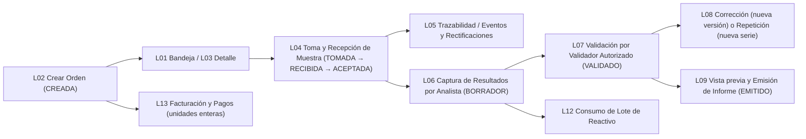

# 09 — Plan de Vistas del Laboratorio Clínico (`L01` a `L14`)

**Fecha:** 19 de octubre de 2026  
**Institución:** Laboratorio Clínico (Motor objetivo en backend: MongoDB — 27 colecciones en esquema v2).  
**Unidades del Roadmap:** `U12` (`L01–L05`), `U13` (`L06–L09`), `U14` (`L10, L11, L14`) y `U15` (`L12, L13`).

---

## 1. Cadena operativa obligatoria del Laboratorio

---

## 2. Mapa de las 14 entradas (`L01`–`L14`)

| ID | Vista | Superficie | Ruta / Anfitrión | Permisos / Roles |
|---|---|---|---|---|
| `L01` | Bandeja de trabajo | `ruta` | `/laboratorio/bandeja` | Recepción, Analista, Validador |
| `L02` | Crear/editar orden | `ruta` / `formulario` | `/laboratorio/ordenes/nueva` | Recepción / personal autorizado |
| `L03` | Detalle y seguimiento de orden | `ruta` | `/laboratorio/ordenes/:ordenId` | Personal de laboratorio |
| `L04` | Registro y recepción de muestras | `ruta` / `formulario` | `/laboratorio/muestras` | Recepción, Toma de muestra, Analista |
| `L05` | Trazabilidad de muestra | `pestaña` | Subvista en `L03` y `L04` | Personal de laboratorio |
| `L06` | Captura de resultados | `ruta` / `formulario` | `/laboratorio/resultados/captura/:ordenId` | Analista (`resultados.analizar`) |
| `L07` | Revisión y validación de resultados | `ruta` / `flujo` | `/laboratorio/resultados/validacion` | Validador (`resultados.validar`) |
| `L08` | Corrección/repetición y versiones | `pestaña` / `modal` | Subvista en `L06` y `L07` | Analista / Validador |
| `L09` | Vista previa y emisión de informe | `ruta` / `pestaña` | `/laboratorio/informes/:ordenId` y tab en `L03` | Validador / Emisor (`informes.emitir`) |
| `L10` | Catálogo de laboratorio | `pestaña` | `/administracion/catalogos?tab=laboratorio` (`V17`) | Administrador de laboratorio |
| `L11` | Equipos y control de calidad | `ruta` | `/laboratorio/calidad` | Analista, Validador, Administrador |
| `L12` | Reactivos, lotes e inventario | `ruta` | `/laboratorio/inventario` | Rol con `inventario.administrar` |
| `L13` | Facturas y pagos | `ruta` | `/laboratorio/cobros` | Caja / Admin (`cobros.administrar`) |
| `L14` | Personal y permisos de laboratorio | `pestaña` | `/administracion/usuarios?tab=personal-laboratorio` (`V15`/`V16`) | Administrador (`usuarios.administrar`) |

---

## 3. Reglas críticas de negocio en la simulación (`CA12`–`CA16`, `CA18`)

1. **Separación estricta entre captura (`L06`) y validación (`L07`):**
   - Un usuario con permiso `resultados.analizar` pero sin `resultados.validar` puede capturar y guardar resultados en `BORRADOR`, pero **no puede validarlos** ni emitir informes (`L09`), ni siquiera navegando directamente a `/laboratorio/resultados/validacion` (`CA18`).
   - Un resultado de laboratorio **nunca se convierte automáticamente en diagnóstico clínico ni en receta**.
2. **Muestras, rechazos, retomas y rectificaciones (`L04`, `L05`, `CA12`):**
   - Estados de muestra: `TOMADA → RECIBIDA → ACEPTADA → PROCESADA`, o `RECHAZADA` con motivo obligatorio.
   - Rechazar una muestra no cancela automáticamente la orden; permite registrar una **retoma**, que genera un **nuevo documento de muestra** con su propio código único.
   - Corregir un dato administrativo de la muestra agrega un evento en `eventos_muestra` con `campo`, `valor_anterior`, `valor_nuevo`, `actor`, `fecha` y `motivo`.
3. **Series y versiones de resultados e informes (`L06–L09`, `CA12`, `CA13`):**
   - Corregir un resultado ya `VALIDADO` crea una **nueva versión** (`version + 1`) dentro de la misma `serie_resultado_id`, conservando inmutable la versión anterior.
   - Repetir el análisis desde una muestra nueva crea una **nueva serie** (`serie_resultado_id` distinto, `version = 1`).
   - Un informe (`L09`) solo pasa a `EMITIDO` si todos los resultados incluidos pertenecen a la misma orden/paciente y están en estado `VALIDADO`. Guarda los IDs y versiones exactas de esos resultados.
4. **Inventario de reactivos (`L12`, `CA15`):**
   - El saldo disponible de cada lote se calcula como `entradas + ajustes_entrada - consumos - ajustes_salida - bajas`.
   - No se permite consumir de un lote `VENCIDO` o `INACTIVO`, ni dejar saldo negativo, incrementando `revision_stock` en cada movimiento.
5. **Facturación y pagos en unidades enteras (`L13`, `CA14`):**
   - Importes expresados en centavos enteros (`unidades_menores`) de una sola moneda (`GTQ`), sin coma flotante.
   - `saldo_pendiente = total_factura - total_pagado`. Se rechazan pagos superiores al saldo pendiente o duplicados con la misma `Idempotency-Key`. No se anula una factura con pagos confirmados sin registrar antes sus reversiones.
6. **Ampliación clínica acotada (`RF-L13`, `RF-L14`):**
   - Las vistas comunes de citas y consultas (`V08–V13`) en Laboratorio solo se habilitan para el perfil de **Médico responsable vinculado a un solicitante médico individual**, nunca para analistas ni personal de recepción.
