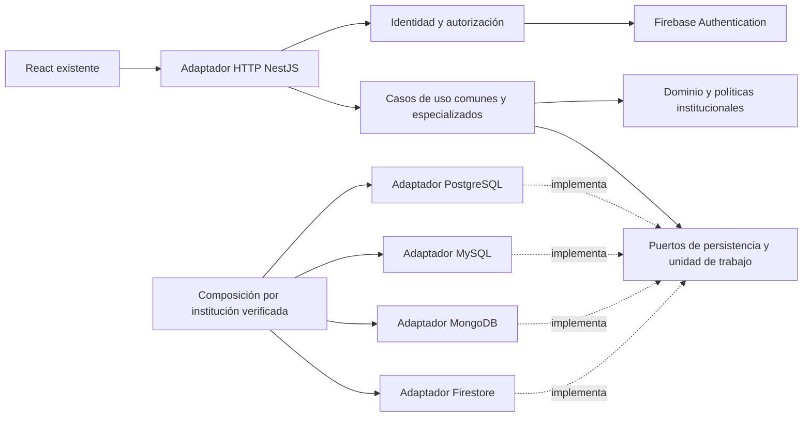

# Arquitectura hexagonal y construcción del backend

## 1. Decisión y dependencias

Monolito modular TypeScript/Node con NestJS en el borde HTTP/composición, siguiendo el diseño adoptado. Reutilizar `Frontend/` React/Vite y `Database/`. Drivers previstos: `pg`, `mysql2`, driver oficial MongoDB y Firebase Admin. E01-P1-01 fija versiones compatibles, runtime y lockfile después de comprobar documentación oficial; este plan no instala dependencias ni promete una versión futura concreta.

Dependencia de código: adaptadores → aplicación → dominio. El dominio no importa Nest, SDK, React, variables de entorno ni HTTP. Aplicación declara puertos y recibe implementaciones por constructor. Decoradores Nest, tokens y factories pertenecen a composición/adaptadores. Las interfaces TypeScript no son tokens de ejecución: usar tokens explícitos y factories que construyan los casos de uso ordinarios. Véase [proveedores personalizados de NestJS](https://docs.nestjs.com/fundamentals/custom-providers).



Las flechas punteadas indican implementación de contratos, no llamadas del dominio a SDK. La selección física pertenece a composición; una política institucional puede exigir cita o responsable sin conocer qué motor almacena sus datos.

## 2. Estructura prevista

```text
Backend/
  src/
    dominio/
      compartido/             # UUID público, fechas, dinero, errores, versión
      clinica/                # paciente, historial, consulta, receta, políticas
      hospital/               # ingreso, cama, examen, cobertura
      odontologia/            # políticas de atención con cita
      laboratorio/            # orden, muestra, resultado, informe, saldo, lote
      pediatria/              # responsable, crecimiento, esquema, aplicación
    aplicacion/
      puertos/                # interfaces, contexto autenticado, UoW
      casos-uso/
        pacientes/ citas/ consultas/ historiales/
        hospital/ odontologia/ laboratorio/ pediatria/ cuentas/
    adaptadores/
      entrada/http/           # controladores, DTO, validación, guards, errores
      salida/postgresql/      # mappers, repositorios, consultas, UoW
      salida/mysql/
      salida/mongodb/
      salida/firestore/
      salida/identidad/        # Firebase Auth, provisión/revocación
      salida/archivos/         # informes, hash, descarga autorizada
    composicion/              # providers Nest, mapa institución→bundle
    configuracion/            # entorno validado, perfiles desarrollo/prueba/entrega
    main.ts
  tests/
    unitarios/ contratos/ integracion/ seguridad/ e2e/ fixtures/
  docs/openapi.yaml           # artefacto generado y revisado contra contrato
  scripts/                   # seed sintético, provisión y verificaciones
  .env.example
  package.json
  package-lock.json
```

Son rutas a crear; no afirmar que existen. Mantener un repositorio por agregado/capacidad, no uno genérico que permita escribir cualquier tabla. Los mappers SQL conservan PK internas y traducen UUID; los documentales convierten BSON/Timestamp y estructuras embebidas sin exponerlas al API. Reutilizar el validador de `Database/firebase/modelo_pediatrico.mjs` desde una frontera de persistencia comprobando empaquetado/ESM; no copiar silenciosamente sus reglas ni importarlo en dominio, porque depende de Firebase/Zod.

## 3. Puertos mínimos y responsabilidad

| Puerto | Operaciones/contrato de responsabilidad |
|---|---|
| VerificadorIdentidad | Verificar token, revocación y claims; devolver UID/localizador institucional, sin decidir permisos clínicos |
| RepositorioCuenta | Obtener cuenta por UID, estado, roles y profesional activo; ámbito fijado por bundle |
| UnidadDeTrabajo | Ejecutar un comando atómico con repositorios ligados a una conexión/sesión; rollback y reintento acotado |
| RepositorioPaciente / Identidades | Crear/editar perfil y apertura; reservar identidad única; no fusionar solo por nombre |
| RepositorioConsulta / Cita | Consultas, diagnósticos, tratamientos, receta y citas con versión/propiedad verificadas |
| ConsultaHistorial | Proyecciones autorizadas y paginadas de todos los eventos habilitados |
| RepositorioOperaciones | Leer/reservar resultado idempotente por institución/actor/caso/clave y hash canónico |
| RepositorioRevisiones / Auditoria | Guardar instantánea anterior y evento en la misma transacción; no CRUD arbitrario |
| Hospital / Laboratorio / Pediatria | Puertos específicos para agregados de cada institución; no filtrarlos a las otras |
| AlmacenInformes | Preparar/leer archivo inmutable y verificar hash; descargar tras autorización |
| Reloj / GeneradorIds | Tiempo e identificadores sustituibles en pruebas y estables durante reintentos |

Los DTO de presentación no son entidades. Una consulta completa recibe datos, IDs públicos, versión cuando corresponde y contexto autenticado separado. Ningún caso de uso acepta un motor como argumento de negocio.

## 4. Unidad de trabajo compatible con los cuatro motores

Contrato conceptual: `ejecutar(contexto, comando, planificador)` devuelve el resultado confirmado. El planificador recibe un lector transaccional, carga todas las referencias necesarias, valida reglas y devuelve un **plan de escrituras** más respuesta. El adaptador aplica el plan; después confirma. Así Firestore realiza las lecturas antes de las escrituras y los casos comunes no dependen de leer después de escribir. Un comando compuesto calcula en memoria consulta/diagnósticos/tratamientos/receta y los persiste juntos; no llama a endpoints hijos ni abre transacciones anidadas.

1. Fuera del callback: verificar entrada, fijar correlación/UUID/instante del comando. Resolver bundle institucional inmutable por petición. No cambiar un singleton global llamado «motor actual».
2. Dentro de transacción: leer operación previa, cuenta/estado cuando una escritura sensible requiera revalidación, agregados, versiones, reservas y referencias. Si la operación ya existe y coincide el hash, devolver su resultado autorizado sin escribir.
3. Evaluar reglas y producir plan completo. Incluir reserva, revisión previa, datos, operación idempotente y auditoría. No escribir una operación «exitosa» antes de los datos.
4. Aplicar escrituras condicionadas a versión o bloqueo. La violación de unicidad concurrente se traduce al error común o se relee la operación idempotente en un intento nuevo.
5. Confirmar y responder. Ante resultado de commit incierto, reconciliar por clave antes de repetir; no crear otra clave para esconder timeout.

| Motor | Implementación y conflicto que debe probarse |
|---|---|
| PostgreSQL | Misma conexión `BEGIN/COMMIT/ROLLBACK`, bloqueos donde se requiere serializar; preservar checks/FK/constraint diferida de principal. Conflictos cama/identidad y revisión. |
| MySQL | Misma conexión InnoDB; preparar consulta ABIERTA, principal y detalle antes de finalizar; no mezclar consultas fuera de la conexión transaccional. Deadlock revierte/reintenta comando completo. |
| MongoDB | Session compartida en replica set; todas las operaciones llevan esa session. Incrementar revisión del agregado compartido para provocar conflicto en stock, factura, archivo y procesos relacionados. |
| Firestore | Callback repetible, todas las lecturas previas a escrituras; reservas/documentos deterministas y revisión del paciente en cambios de vínculos. Ninguna llamada a Auth, disco o descarga en callback. |

Firestore puede repetir el callback ante contención; no debe producir efectos externos. La secuencia lectura→escritura se basa en [transacciones de Firestore](https://firebase.google.com/docs/firestore/manage-data/transactions). Para los cuatro motores se propone un máximo configurable de 3 intentos para conflictos transitorios, con espera breve y plazo total acotado; validar comportamiento exacto del driver en E01. No reintentar errores de dominio, permisos, versión esperada o entrada inválida.

## 5. Identidad, sesión y provisión

React usa Firebase Authentication para obtener ID token; solo el token viaja a la API. Backend verifica emisor, audiencia, firma, vencimiento y revocación; consulta cuenta vigente en la base institucional. La [verificación de ID tokens](https://firebase.google.com/docs/auth/admin/verify-id-tokens) no equivale por sí sola a comprobar revocación: habilitarla explícitamente en el adaptador. Roles/estado se cargan en cada petición; no confiar en campos enviados por React.

Claims usan las cuatro constantes de persistencia, incluida `CENTRO_MEDICO_PEDIATRICO`. Los bundles permitidos son configuración del servidor; una institución desconocida no genera una conexión dinámica. Devolver 404 al pedir recurso ajeno, 403 al carecer de capacidad/permiso y 401 por token inválido. Secretaría recibe perfil administrativo, no notas clínicas.

Provisión es un proceso recuperable entre Auth y una base, no una transacción distribuida. Cuenta PENDIENTE → crear/vincular UID y claim → verificar vínculo único → ACTIVA. Serializar provisión por UID mediante herramienta administrativa única y operación idempotente; revisar vínculos existentes antes de activar y tratar activaciones concurrentes en E06. Si falla, mantener PENDIENTE y reanudar por ID de operación. Desactivar local primero; si revocación falla queda sin acceso local y se registra reintento. El alta de cuentas desde UI se limita al laboratorio; para otras instituciones usar provisión/seed administrativa controlada, sin panel nuevo.

## 6. Informes y otras fronteras no atómicas

El PDF/archivo de informe de laboratorio se prepara fuera de la transacción con clave determinista, contenido versionado y hash. Solo pasar BORRADOR→EMITIDO si el objeto existe y coincide el hash, y una transacción revalida las versiones de resultados y guarda referencia/auditoría. Un timeout o fallo de almacenamiento conserva borrador; reintentar la misma operación; limpiar temporales huérfanos por tarea controlada. Las descargas atraviesan autorización, nunca una ruta pública de archivo clínico. No hace falta un servicio externo de objetos para la demo: un adaptador local protegido es suficiente si se incluye en respaldo/restauración.

## 7. Integración con React y límites

Crear `Frontend/src/services/http/` y un factory explícito de modo `mock` o `api`. Modo entrega exige `api` y falla visiblemente si falta servidor; no vuelve a simuladores como fallback. Los repositorios HTTP implementan los métodos usados por vistas vigentes, transforman nombres/fechas/versiones y traducen errores. Los mocks quedan como herramientas de pruebas de presentación. La UI conserva su aspecto por institución/capacidad y nunca cambia por nombre de motor.

Comprobar arquitectura con una regla automatizada de imports: dominio/aplicación no importan carpetas de adaptadores, `@nestjs/*`, drivers ni `process.env`; probar casos comunes con dobles y con los cuatro adaptadores. La prueba con dobles demuestra independencia, no atomicidad de una base.
